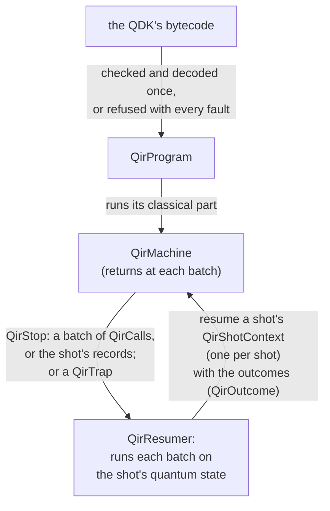
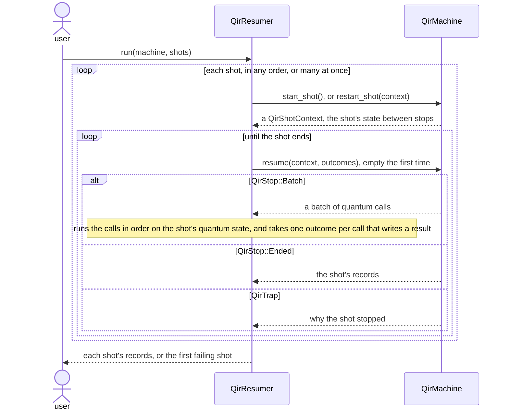

# QIR programs on a machine and its resumers

The [`qir`](../qir.rs) module of `qdk_simulators` runs the programs the
QDK compiles today, Adaptive Profile QIR programs, on any quantum
target. A machine runs their classical part, written once, and hands
each batch of quantum calls to whoever resumes it, a resumer. The
machine is pulled: it never calls its target, it stops at each batch
and waits to be resumed. So each resumer decides how its shots run
(one by one, grouped by their next batch, awaiting a device, paused by
a debugger), while the program's classical part stays in one
implementation for every target.

## The problem

The QDK [compiles](../../../qdk_package/qdk/_adaptive_pass.py) an
Adaptive Profile QIR program to a bytecode, and three interpreters run
it today, each written for one target:
[`run_shot`](../bytecode/runtime.rs) for the CPU simulators,
[a shader](../gpu_full_state_simulator/gpu_statevector_shaders.wgsl) for
the GPU simulator, and
[an interpreter](../../../qdk_package/qdk/simulation/_qodec/_interpreter.py)
for the Qodec runtime. Each implements the same classical semantics
(branches, arithmetic on measured values, records) and calls its target
as it goes, so:

- **Duplication.** A new target needs a new interpreter, and the copies
  drift: a recursion nine calls deep stops the shader's shot, where
  `run_shot` and Qodec's interpreter run on.
- **No composition.** Noise, an error-correcting code or an observer
  between the program and its target must be written into an
  interpreter, for that target alone.
- **A fixed way to run shots.** None can await a target that answers
  later, send one call for the shots whose next batch is equal, or stop
  between two batches, which a device, a GPU and a debugger need.

## The model

Three parts, which meet at a batch of quantum calls and its outcomes:

- A [`QirProgram`](program.rs) is built once from the bytecode, which it
  checks, refusing every fault it shows at once. It says before any shot
  what a shot needs: qubits, results, instructions.
- A [`QirMachine`](machine.rs) runs the program's classical part. Rather
  than call a simulator, it returns to its caller at each batch of quantum
  calls. A shot's state lives in its own
  [`QirShotContext`](machine/shot_context.rs), so one machine, which
  holds only the program, serves any number of shots, on any thread.
- A [`QirResumer`](resumer.rs) holds each shot's quantum state. It
  resumes a shot's context, gets the batch of quantum calls
  ([`QirCall`](call.rs)) at which it stops, runs them on that state, and
  resumes the context with their outcomes ([`QirOutcome`](call.rs)).



Step by step, for a run of shots:



## A resumer, in a few lines

A resumer drives each shot with the loop below, where `run` runs a batch
on the shot's quantum state (a simulator, a device) and gives the
batch's outcomes, one per call that writes a result:

```rust
machine.restart_shot(context);
let mut outcomes = Vec::new();
loop {
    match machine.resume(context, &outcomes)? {
        QirStop::Batch(batch) => {
            outcomes.clear();
            run(batch, &mut outcomes);
        }
        QirStop::Ended(records) => return Ok(records.to_vec()),
    }
}
```

A resumer implements [`QirResumer`](resumer.rs), whose `run` states the
rules it keeps.

## Where a program comes from

`QirProgram::new` takes the bytecode that the QDK's
[adaptive pass](../../../qdk_package/qdk/_adaptive_pass.py) writes.
The package's `run_qir_cpu` and `run_qir_clifford`
([`_simulation.py`](../../../qdk_package/qdk/simulation/_simulation.py))
run the pass and hand its `as_dict()` to Rust, where
`adaptive_program_from_pydict`
([`qir_simulation.rs`](../../../qdk_package/src/qir_simulation.rs)) makes
the `AdaptiveProgram<u64>` that `run_shot` runs today. Nothing in the
package builds a `QirProgram` yet, so the tests write the bytecode by
hand.
[`bytecode/encoding.rs`](../bytecode/encoding.rs) mirrors the pass's
encoding.

## Which type for what

| Type                                                                               | A caller uses it to                                                                |
| ---------------------------------------------------------------------------------- | ---------------------------------------------------------------------------------- |
| [`QirProgram`, `TwoQubitGate`, `MeasuredQubit`](program.rs)                        | build a program once, and learn what its shots need                                |
| [`QirMachine`, `QirStop`](machine.rs), [`QirShotContext`](machine/shot_context.rs) | run the classical part: start a context, then resume it with outcomes at each stop |
| [`QirResumer`, `QirShotId`, `QirResumeError`](resumer.rs)                          | run shots on a quantum state of one's own, and learn which shot failed first       |
| [`QirCall`, `QirInstruction`, `QirQubits`, `QirOutcome`, `QirReadout`](call.rs)    | read a batch's calls, and answer each call that writes a result                    |
| [`QirGate`](gate.rs)                                                               | take a gate call's matrix, at its angle                                            |
| [`QirFaults`, `QirFault`, `QirFaultSite`, `QirError`, `SideTable`](fault.rs)       | learn every fault building found in the bytecode, where it is and what it is       |
| [`QirTrap`](trap.rs)                                                               | learn why a context stopped on a fault found while it runs                         |

Each file's header gives the rules of its part.

## Why this design

The common pattern of the three interpreters is abstracted once: run
the classical part and hand batches of quantum calls to the target.

- **Decoupling.** The machine knows nothing of what runs the quantum
  part, and the target knows nothing of the program: it runs quantum
  calls only, not branches, registers or records.
- **One implementation.** One runtime of the bytecode serves every
  target, instead of an interpreter per target.
- **Open for extension, closed for modification.** A new target or a new
  resumer is added without changing the machine.
- **Single responsibility.** Building checks, the machine runs the
  classical part, the resumer runs the batches; each is tested on its
  own.
- **Pull, not push.** Because the resumer asks the machine for the next
  batch, one machine serves resumers with opposite needs: synchronous or
  asynchronous, one shot or many, stepping or not
  ([why pull](design.md#why-a-pull-machine)).

The parts were found from concrete needs, each a choice of the resumer
and none a change to the machine:

| Need                | Case                                                   | Status                                                                                             |
| ------------------- | ------------------------------------------------------ | -------------------------------------------------------------------------------------------------- |
| A new target        | a matrix-product-state simulator, a device             | the resumer contract and [the MPS simulator](../mps_simulator/README.md): built; a device: planned |
| Efficiency          | the CPU simulators, as fast as `run_shot`              | built; its benchmark: planned                                                                      |
| Many shots per call | a GPU, a device                                        | the machine and a grouping resumer, the MPS simulator's: built; a device's: planned                |
| Concurrency         | a device that answers later                            | the async trait: built; a device: planned                                                          |
| Threads             | shots run on several threads                           | the machine: built; a resumer on threads: planned                                                  |
| Composability       | Qodec's and QEP's codes, noise, an observer in between | planned                                                                                            |
| Stepping, copying   | a debugger; shots that share a prefix                  | a context can be left or cloned; a debugger: planned                                               |
| One runtime for all | the GPU simulator, with an interpreter in its shader   | planned: a GPU resumer on the shader's kernels                                                     |

## The evidence

[The module's tests](../tests/qir/) pin each rule of building and
of the machine, one rule per test. Where the machine differs from
`run_shot`, the test or the check says why (`COMPATIBILITY NOTE`), or
asks for a review (`DISCUSS COMPATIBILITY`).

## Planned optimizations

None changes what a shot records; each waits for the case that needs it.

- **The sampled form.** A program whose shots never send a batch after
  the outcomes of an earlier one (a Base Profile program, usually) gives
  every shot the same single batch. So a simulator may run that batch
  once and sample every shot from the one state, rather than run it once
  per shot: a Base Profile program on a matrix product state, at 1,000
  shots, would run its circuit once rather than 1,000 times (to be
  measured). Telling such a program apart before any shot takes an
  analysis of the bytecode, which must be conservative so that its "no"
  can be trusted. The analysis and the sampled form were written and
  tested, then removed until their first user: they return with it.
- **A limit on a batch's size.** A batch ends only where a shot needs
  one of its outcomes, so a program that reads none until its end, and
  writes each result once, is one batch, which grows with the program: a
  Trotter evolution whose loop the compiler unrolls is one long line of
  gates, and a loop of gates that reads nothing adds every round to the
  batch. `resume` could take a
  maximum number of calls and yield early, so that a target runs a long
  batch's first part while the machine walks the rest, and a target with
  a bounded queue is never sent more than it holds. No case needs it yet;
  it is to be decided with the targets' back-pressure, measured on H₂.
- **Resumers' optimizations** need no change to the machine: see the
  table of [Why this design](#why-this-design).

## Further reading

[The design notes](design.md): one shot traced from QIR to its records,
why the machine is pulled, and the choices that leave no trace in the
code.
