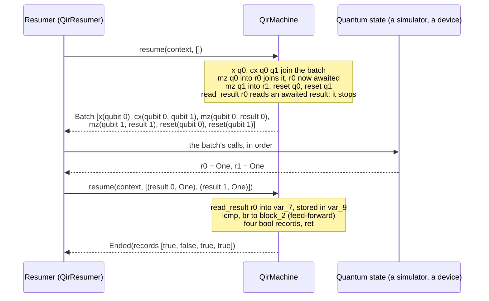

# The QIR machine: design notes

The [README](README.md) gives the model: a program, a machine that runs
its classical part, and resumers that run its quantum calls. Each file's
header gives the rules of its part. This page adds what neither holds:
one shot traced from QIR to its records, why the machine is pulled, the
names and their precedents, and the choices that leave no trace in the
code.

## Where the details are

| Topic                                              | File                                                                                                                                           |
| -------------------------------------------------- | ---------------------------------------------------------------------------------------------------------------------------------------------- |
| What building refuses, and why                     | [`fault.rs`](fault.rs) (`QirError`), [`program/check.rs`](program/check.rs)                                                                    |
| When a context stops, and what traps               | [`machine.rs`](machine.rs) (`QirMachine`), [`trap.rs`](trap.rs)                                                                                |
| Lost and missing readouts                          | [`call.rs`](call.rs) (`QirReadout`)                                                                                                            |
| A resumer's rules, and the kit that checks them    | [`resumer.rs`](resumer.rs), [`resumer/conformance.rs`](resumer/conformance.rs)                                                                 |
| How a quantum instruction becomes a call           | [`quantum_instruction_encoding.rs`](quantum_instruction_encoding.rs), [`program/prepared_quantum_calls.rs`](program/prepared_quantum_calls.rs) |
| Where the machine differs from `run_shot`, and why | [the `run_shot` compatibility test](../../tests/run_shot_compatibility/main.rs)                                                                |
| What a shot costs                                  | [the benchmark](../../benches/qir_machine.rs)                                                                                                  |

## One shot, from QIR to its records

The program `MeasurementComparison` of the Python package's tests
([`MeasurementComparison.ll`](../../../qdk_package/tests-integration/resources/adaptive/output/MeasurementComparison.ll)),
cut (`…`) and annotated (the `;` comments):

```llvm
block_0:
  %var_9 = alloca i1                                          ; memory
  …
  call void @X(ptr inttoptr (i64 0 to ptr))                   ; qubit 0
  call void @CNOT(ptr inttoptr (i64 0 to ptr), ptr inttoptr (i64 1 to ptr))
  call void @__quantum__qis__m__body(ptr inttoptr (i64 0 to ptr), ptr inttoptr (i64 0 to ptr))   ; qubit 0 → result 0
  call void @__quantum__qis__m__body(ptr inttoptr (i64 1 to ptr), ptr inttoptr (i64 1 to ptr))   ; qubit 1 → result 1
  call void @Reset(ptr inttoptr (i64 0 to ptr))
  call void @Reset(ptr inttoptr (i64 1 to ptr))
  %var_7 = call zeroext i1 @__quantum__rt__read_result(ptr inttoptr (i64 0 to ptr))             ; result 0 → register
  store i1 %var_7, ptr %var_9                                 ; register → memory
  …
  %var_18 = icmp eq i1 %var_17, false
  br i1 %var_18, label %block_1, label %block_2              ; feed-forward
  …
block_3:
  …
  %var_36 = load i1, ptr %var_21
  call void @__quantum__rt__bool_record_output(i1 zeroext %var_36, ptr @1)                       ; record: a bool
  …
```

- A **qubit** is an id: the pointer is the id, not an address. Its state
  is the resumer's; a call names it by its id.
- A **result** is a slot that a measurement writes
  (`__quantum__qis__m__body` returns `void`), and only `read_result`
  turns it into a value. That is what lets the quantum part run ahead:
  the machine stops only where the program reads.
- **Registers** (LLVM's SSA values) and **memory** (`alloca`, `load`,
  `store`) are classical, and belong to the shot's context.
- **Records** (`__quantum__rt__*_record_output`) are the context's too,
  given all together when the shot ends; the resumer never sees them.

The `qis` functions are mostly quantum calls, sent to the resumer, and
the `rt` functions mostly classical, run by the machine. The exceptions:
`__quantum__qis__read_result__body` is a read, run by the machine;
`__quantum__rt__readout_noise` is sent to the resumer in the batch; and
the pass drops `__quantum__qis__barrier__body`, `__quantum__rt__initialize`
and `__quantum__rt__{begin,end}_parallel`.

A resumer runs one shot of it so; the records are the output its Python
test expects
([`MeasurementComparison.out`](../../../qdk_package/tests-integration/resources/adaptive/output/MeasurementComparison.out)):



Two resumes, one batch: the quantum part went to the quantum state once,
and every classical instruction ran in the machine. The machine's tests
run this shot from bytecode written by hand from the `.ll` file
([`machine.rs`](../tests/qir/machine.rs)).

## Why a pull machine

The machine is pulled: the resumer asks it for the next batch, and the
machine never calls out. A push machine would own the loop instead,
`run(context, processor)`, calling the processor at each batch, so each
shot's run would live inside the machine's call stack. Pull makes each
need of the [README](README.md#why-this-design) a choice of the resumer,
and none a change to the machine:

| Need                                     | With pull                                                                                   | With push                                                                             |
| ---------------------------------------- | ------------------------------------------------------------------------------------------- | ------------------------------------------------------------------------------------- |
| A target that answers later (a device)   | the resumer awaits the answer, then resumes the shot; the machine never blocks              | the processor blocks the thread, or the machine is async inside                       |
| Many shots per call (a GPU, a device)    | the resumer holds a context per shot, and sends one call for the shots whose batch is equal | each shot runs inside its own call: grouping needs a thread per shot and a rendezvous |
| Threads                                  | a context is data: it moves to another thread                                               | a thread per shot, for its whole run                                                  |
| Stepping, copying (a debugger, a prefix) | the resumer stops by not resuming, and clones a context                                     | a run inside a call stack cannot be cloned or left                                    |
| Testing the semantics                    | outcomes written by hand, no quantum side                                                   | a scripted processor                                                                  |

Push is built on pull in a few lines (each resumer's loop is one), and
not the other way round ([no push helper](#choices-that-leave-no-trace-in-the-code)).

## The names and their precedents

| Concept                                      | Name                                      | Precedent                                                |
| -------------------------------------------- | ----------------------------------------- | -------------------------------------------------------- |
| The executable: checked, immutable           | `QirProgram`                              | a Wasm module                                            |
| Runs the classical part; no state, no I/O    | `QirMachine`                              | an abstract machine; a sans-I/O protocol                 |
| The state of one shot's run, between batches | `QirShotContext`                          | an OS process context; a coroutine's state               |
| Runs a context to its next stop              | `resume`                                  | `std::ops::Coroutine::resume`, `lua_resume`              |
| Where it stopped                             | `QirStop::Batch(calls)`, `Ended(records)` | `std::ops::CoroutineState`: a yield, or a return         |
| A run-time fault, which ends the context     | `QirTrap`                                 | a Wasm trap; a CPU trap (build-time faults: `QirFaults`) |
| Whoever resumes it                           | `QirResumer`; in prose, a resumer         | sans-I/O: the logic names no partner                     |

In OS terms, the machine is a CPU, a context a process's context, the
resumer the kernel, and the quantum side a device: a batch is a blocking
I/O request, which the kernel sends to the device while it may run other
processes, resuming the process with the device's answer.

## Choices that leave no trace in the code

- **No running past a read.** The machine does not run on past a read,
  out of order or down both branches: in QIR a read almost always feeds
  the next branch, and speculation needs a quantum rollback, which
  hardware cannot do. A simulator that can clone its state gets the same
  effect from its resumer, which clones the context with it.
- **Records stop a context like a read.** Recording a result its batch
  writes stops the context; programs record at their end, so this
  usually costs one stop. Deferring records is possible, but no case
  has needed it.
- **A shot's outcomes replay it.** The machine is deterministic: a clone
  of a context runs on as the original would, and a context resumed with
  the same outcomes runs the same way. So a shot's outcomes, in order,
  replay it, whatever produced them (a seeded simulator, or a device
  whose outcomes were recorded). No API offers replay; no case has
  needed one yet.
- **No push helper.** A helper taking a closure,
  `machine.run(context, |batch| …)`, is a few lines on top of `resume`
  (each resumer's loop is one); it is not written, since no caller
  needs it.

## Further reading

- Sans-I/O protocol implementations, the closest design:
  https://sans-io.readthedocs.io/how-to-sans-io.html
- Pull against push parsers (StAX against SAX):
  https://docs.oracle.com/javase/tutorial/jaxp/stax/why.html
- Coroutines: Lua 5.4 manual §2.6 and `lua_resume` (§4.5),
  https://www.lua.org/manual/5.4/manual.html#2.6; Python's
  `generator.send`,
  https://docs.python.org/3/reference/expressions.html#generator.send;
  de Moura and Ierusalimschy, "Revisiting Coroutines",
  https://www.inf.puc-rio.br/~roberto/docs/MCC15-04.pdf
- Rust: `std::ops::Coroutine` (nightly), whose `resume` the machine's
  follows, as `QirStop` follows its `CoroutineState`; and `Future::poll`,
  https://rust-lang.github.io/async-book/
