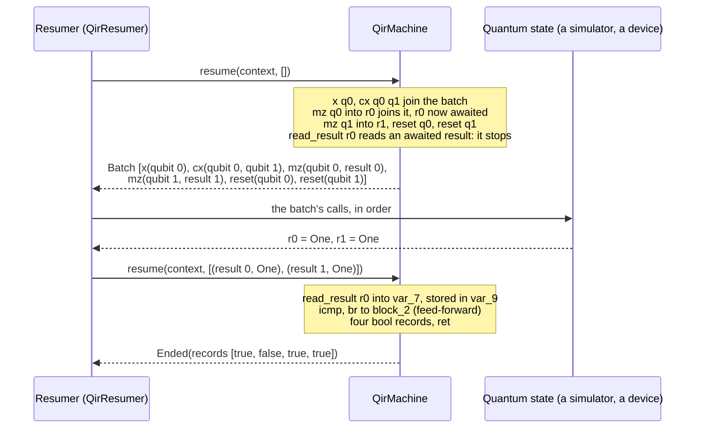

# The QIR machine: design notes

The [README](README.md) gives the model: a program, a machine that runs
its classical part, and resumers that run its quantum calls. Each file's
header gives the rules of its part. This page adds what neither holds:
one shot traced from QIR to its records, why the machine is pulled, why
a batch is handed over whole or in pieces, and the choices that leave no
trace in the code.

## One shot, from QIR to its records

The program `MeasurementComparison` of the Python package's tests
([`MeasurementComparison.ll`](../../../qdk_package/tests-integration/resources/adaptive/output/MeasurementComparison.ll)),
cut (`…`) and annotated (the `;` comments):

```llvm
block_0:
  %var_9 = alloca i1                                          ; memory
  …
  call void @X(ptr inttoptr (i64 0 to ptr))                   ; qubit 0
  call void @CNOT(ptr inttoptr (i64 0 to ptr), ptr inttoptr (i64 1 to ptr))
  call void @__quantum__qis__m__body(ptr inttoptr (i64 0 to ptr), ptr inttoptr (i64 0 to ptr))   ; qubit 0 → result 0
  call void @__quantum__qis__m__body(ptr inttoptr (i64 1 to ptr), ptr inttoptr (i64 1 to ptr))   ; qubit 1 → result 1
  call void @Reset(ptr inttoptr (i64 0 to ptr))
  call void @Reset(ptr inttoptr (i64 1 to ptr))
  %var_7 = call zeroext i1 @__quantum__rt__read_result(ptr inttoptr (i64 0 to ptr))             ; result 0 → register
  store i1 %var_7, ptr %var_9                                 ; register → memory
  …
  %var_18 = icmp eq i1 %var_17, false
  br i1 %var_18, label %block_1, label %block_2              ; feed-forward
  …
block_3:
  …
  %var_36 = load i1, ptr %var_21
  call void @__quantum__rt__bool_record_output(i1 zeroext %var_36, ptr @1)                       ; record: a bool
  …
```

- A **qubit** is an id: the pointer is the id, not an address. Its state
  is the resumer's; a call names it by its id.
- A **result** is a slot that a measurement writes
  (`__quantum__qis__m__body` returns `void`), and only `read_result`
  turns it into a value. That is what lets the quantum part run ahead:
  the machine stops only where the program reads.
- **Registers** (LLVM's SSA values) and **memory** (`alloca`, `load`,
  `store`) are classical, and belong to the shot's context.
- **Records** (`__quantum__rt__*_record_output`) are the context's too,
  given all together when the shot ends; the resumer never sees them.

The `qis` functions are mostly quantum calls, sent to the resumer, and
the `rt` functions mostly classical, run by the machine. The exceptions:
`__quantum__qis__read_result__body` is a read, run by the machine;
`__quantum__rt__readout_noise` is sent to the resumer in the batch; and
the pass drops `__quantum__qis__barrier__body`, `__quantum__rt__initialize`
and `__quantum__rt__{begin,end}_parallel`.

A resumer runs one shot of it so; the records are the output its Python
test expects
([`MeasurementComparison.out`](../../../qdk_package/tests-integration/resources/adaptive/output/MeasurementComparison.out)):



Two resumes, one batch: the quantum part went to the quantum state once,
and every classical instruction ran in the machine. The machine's tests
run this shot from bytecode written by hand from the `.ll` file
([`machine.rs`](../tests/qir/machine.rs)).

## Why a pull machine

The machine is pulled: the resumer asks it for the next batch, and the
machine never calls out. A push machine would own the loop instead,
`run(context, processor)`, calling the processor at each batch, so each
shot's run would live inside the machine's call stack. Pull makes each
need of the [README](README.md#why-this-design) a choice of the resumer.
Those below take no change to the machine; streaming takes one the
machine offers, [a batch in pieces](#a-batch-whole-or-in-pieces), which
the resumer still chooses:

| Need                                     | With pull                                                                                   | With push                                                                             |
| ---------------------------------------- | ------------------------------------------------------------------------------------------- | ------------------------------------------------------------------------------------- |
| A target that answers later (a device)   | the resumer awaits the answer, then resumes the shot; the machine never blocks              | the processor blocks the thread, or the machine is async inside                       |
| Many shots per call (a GPU, a device)    | the resumer holds a context per shot, and sends one call for the shots whose batch is equal | each shot runs inside its own call: grouping needs a thread per shot and a rendezvous |
| Threads                                  | a context is data: it moves to another thread                                               | a thread per shot, for its whole run                                                  |
| Stepping, copying (a debugger, a prefix) | the resumer stops by not resuming, and clones a context                                     | a run inside a call stack cannot be cloned or left                                    |
| Testing the semantics                    | outcomes written by hand, no quantum side                                                   | a scripted processor                                                                  |

Push is built on pull in a few lines (each resumer's loop is one), and
not the other way round ([no push helper](#choices-that-leave-no-trace-in-the-code)).

## A batch whole or in pieces

A batch ends only where a shot needs one of its outcomes, or writes
again a result the batch writes, so a program that reads none until its
end, and writes each result once, is one batch, which grows with the
program: a Trotter evolution whose loop the compiler unrolls is one long
line of gates, and a loop of gates that reads nothing adds every round
to the batch. A resumer that streams the calls to its target needs them
sooner: a target with a bounded queue is never sent more than it holds,
and a target runs a long batch's first part while the machine walks the
rest. Only the machine can bound what a context holds; a resumer can
split further what it receives on its own.

So the machine hands a batch over whole
([`WholeBatches`](machine/batch_split/whole_batches.rs), the default) or
in pieces of at most `n` calls
([`SplitBatches`](machine/batch_split/split_batches.rs), whose doc
states what the pieces keep). A batch is cut inside a run of prebuilt
calls too, since one run can hold thousands of calls (an unrolled
Trotter step).

A batch whose walk traps has no end, and the two choices differ there.
Whole, none of its calls is handed over: none was sent yet, so no call
of the failed shot's last batch runs. Split, every call walked before
the trap is handed over, the last ones as a `QirStop::Split`, and the
next resume gives the trap: a resumer that streams may have sent the
batch's first pieces already, so it is given the rest too, and its
target has received every call the shot made before it failed, as a
device that runs calls as they come would have run them, rather than a
stream cut at a piece's edge.

The resumer chooses once, when it takes the machine (`with_split`), and
the choice is a type parameter of the machine and of its stops:

| Option                                                     | For                                                                                                                   | Against                                                                                                                   |
| ---------------------------------------------------------- | --------------------------------------------------------------------------------------------------------------------- | ------------------------------------------------------------------------------------------------------------------------- |
| A type parameter (built)                                   | one `resume`; a resumer of whole batches has no `Split` arm and is never given a split; each choice is compiled alone | a generic on `QirMachine` and `QirStop`; a resumer that chooses at run time writes its loop generic over the split choice |
| `WholeBatches` as `SplitBatches` with no limit             | one type fewer                                                                                                        | `Split` exists for every resumer, so each `match` needs its arm; the default pays a check per quantum call                |
| Two methods, `resume` and one that splits                  | `resume` untouched                                                                                                    | a method and a stop type per choice                                                                                       |
| A field of the machine read at run time, and one stop type | no generics                                                                                                           | every resumer matches a variant it never gets; a branch per quantum call on the default path                              |
| An argument of `resume`                                    | explicit at each call                                                                                                 | the choice can change in the middle of a batch, which no case needs                                                       |

Under `WholeBatches`, the walk is compiled with no count of calls, so
on the default path the walk pays nothing for the choice; a resume
checks once for a trap held by a split, and a context holds room for
one.

Planned, each kept out until a case needs it:

- **Pieces cut by rule**, `SplitBatches::when(rule)`, cutting where a rule
  on the calls so far and the next call says, `at_most(n)` being one
  rule: to hand a stream over at a meaningful point sooner (the end of a
  Trotter step, before a non-Clifford gate), or within a byte budget.
  `SplitBatches`' fields are private, so adding it breaks nothing.
- **Fed-forward calls** (`FeedForwardCalls`), a second choice beside the
  split choice: a gate in a batch that runs only where results of the
  batch take given values, so that the batch need not end at the read that
  decides it. A GPU applies such a gate in the same kernel round, a
  Pauli-frame sampler as a frame update, and a device with real-time
  feed-forward as a classically controlled gate.

## Choices that leave no trace in the code

- **No running past a read.** The machine does not run on past a read,
  out of order or down both branches: in QIR a read almost always feeds
  the next branch, and speculation needs a quantum rollback, which
  hardware cannot do. A simulator that can clone its state gets the same
  effect from its resumer, which clones the context with it.
- **Records stop a context like a read.** Recording a result its batch
  writes stops the context; programs record at their end, so this
  usually costs one stop. Deferring records is possible, but no case
  has needed it.
- **A shot's outcomes replay it.** The machine is deterministic: a clone
  of a context runs on as the original would, and a context resumed with
  the same outcomes runs the same way. So a shot's outcomes, in order,
  replay it, whatever produced them (a seeded simulator, or a device
  whose outcomes were recorded). No API offers replay; no case has
  needed one yet.
- **No push helper.** A helper taking a closure,
  `machine.run(context, |batch| …)`, is a few lines on top of `resume`
  (each resumer's loop is one); it is not written, since no caller
  needs it.

## Further reading

- Sans-I/O protocol implementations, the closest design:
  https://sans-io.readthedocs.io/how-to-sans-io.html
- Pull against push parsers (StAX against SAX):
  https://docs.oracle.com/javase/tutorial/jaxp/stax/why.html
- Coroutines: Lua 5.4 manual §2.6 and `lua_resume` (§4.5),
  https://www.lua.org/manual/5.4/manual.html#2.6; Python's
  `generator.send`,
  https://docs.python.org/3/reference/expressions.html#generator.send;
  de Moura and Ierusalimschy, "Revisiting Coroutines",
  https://www.inf.puc-rio.br/~roberto/docs/MCC15-04.pdf
- Rust: `std::ops::Coroutine` (nightly), whose `resume` the machine's
  follows, as `QirStop` follows its `CoroutineState`; and `Future::poll`,
  https://rust-lang.github.io/async-book/
