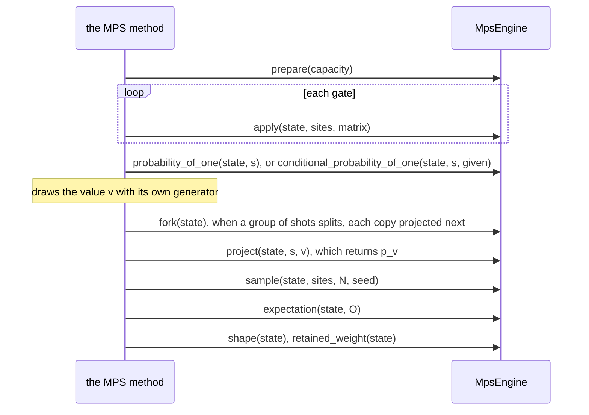

# The MPS engine contract

`tensornet` is the contract between a simulation method that runs matrix
product states (MPS) and the library that holds them. The method asks an
engine (`MpsEngine`) for a state within a capacity (`MpsShape`). It applies
unitaries to the state's sites, reads probabilities, projects and forks the
state, samples it from a seed, and reads expectations of Pauli sums. The
engine answers in tensor terms. It refuses a call that breaks the contract
the same way on every engine (`Refusal`).

## The problem

A simulator that runs a program as a matrix product state needs a library to
hold the chain of site tensors: one on the CPU, or cuTensorNet on a GPU.
Each library has its own types, layouts and limits. Without a contract
between them, every simulator would speak each library's language, and each
library would answer the same question its own way: which bit of a matrix is
which site, whether a read is normalized, what a truncation cost, which call
is an error. This crate states the contract once, in tensor terms only
(sites, matrices, probabilities and seeds), with an exact engine to check
every other one against.

## The approach

One trait, `MpsEngine`, states what a library does for a simulation method,
in terms every MPS library shares; what one library alone needs stays in its
engine. So a method is written once, against the trait. A new library is a
new engine, with no change to the method or to the other engines. Each
promise is stated once, in the rustdoc of the item that keeps it, where an
implementer reads it. The functions of `checks` make the refusals of the
arguments; every engine calls them, so engines agree on them. An exact
engine, `ExactReference`, gives the answer every engine with enough bond
must give, to check an engine's answers against.

## The model

Today the crate holds:

- **The engine.** [`MpsEngine`](src/engine.rs) is what a library that holds
  matrix product states does for a simulation method;
  [The engine](#the-engine) goes through it method by method. It speaks in
  tensor terms; the method keeps its instructions, its shots and its
  generator. Beside it:
  - [`MpsEngineError`](src/engine/mps_engine_error.rs) is the bound of an
    engine's error: its `refusal` method tells a refusal from the engine's
    own failure;
  - [`Refusal`](src/engine/refusal.rs) is why an engine refused a call, the
    same on every engine: its arguments break the contract, or name an
    outcome of probability zero or NaN;
  - [`checks`](src/engine/checks.rs) holds one function per method that can
    refuse a call, which makes the refusals of its arguments;
  - [`sampling`](src/engine/sampling.rs) is what every engine's `sample`
    shares. `sample_by_conditionals` draws the values from the engine's
    conditional probabilities, so an engine that draws them itself writes
    only its probability call. `TooManyValues` is its failure when the
    values do not fit in memory;
  - [`ExactReference`](src/engine/reference.rs) is the exact engine: a dense
    state vector of at most `ExactReference::MAX_SITES` sites that never
    truncates, exact within the limits its rustdoc states. It is for tests,
    not for simulation (feature `conformance`).
- **The chain's shape.** [`MpsShape`](src/mps_shape.rs) is the shape of a
  chain, by the extents of its sites alone. It describes both the capacity a
  caller asks for and the chain an engine holds. `MpsShape::qubit_chain(n, χ)`
  is the capacity of `n` qubits with bonds at most χ, the max bond
  dimension. `MpsShape::largest_bond_dimension` is the largest bond
  dimension a chain holds. `MpsShapeError` says why a shape was not built.
- **The observables.** [`PauliSum`](src/pauli_sum.rs) is the observable an
  engine reads, on sites: an identity coefficient and `PauliTerm`s, each a
  coefficient times `Pauli` factors on distinct sites. `PauliSumError` says
  why a term or a sum was not built.

A Bell pair on the reference, read four ways (the crate's doctest in
[`src/lib.rs`](src/lib.rs), which every `cargo test` runs):

```rust
use num_complex::Complex64;
use tensornet::reference::ExactReference;
use tensornet::{MpsEngine, MpsShape, Pauli, PauliSum, PauliTerm};

let (o, l, h) = (0.0, 1.0, std::f64::consts::FRAC_1_SQRT_2);
let c = |re| Complex64::new(re, 0.0);
let hadamard = [c(h), c(h), c(h), c(-h)];
// Row-major, `M[out][in]`, `sites[0]` the most significant bit.
let cx = [l, o, o, o, o, l, o, o, o, o, o, l, o, o, l, o].map(c);

let engine = ExactReference::new();
let capacity = MpsShape::qubit_chain(2, 2).expect("two sites form a chain");
let mut state = engine.prepare(&capacity)?;
engine.apply(&mut state, &[0], &hadamard)?;
engine.apply(&mut state, &[0, 1], &cx)?;

let p1 = engine.probability_of_one(&state, 1)?;
assert!((p1 - 0.5).abs() < 1e-12);

let zz = PauliTerm::new(c(1.0), vec![(0, Pauli::Z), (1, Pauli::Z)])?;
let zz = PauliSum::new(c(0.0), vec![zz])?;
assert!((engine.expectation(&state, &zz)? - c(1.0)).norm() < 1e-12);

let values = engine.sample(&state, &[0, 1], 100, 7)?;
assert!(values.chunks_exact(2).all(|shot| shot[0] == shot[1]));

assert_eq!(engine.shape(&state)?.largest_bond_dimension(), 2);
```

The crate depends only on `thiserror` and `num-complex`, so it builds for
every target the QDK supports, WebAssembly included. The API reference is the
rustdoc (`cargo doc -p tensornet --open`), which states the contract;
[`docs/design.md`](docs/design.md) says why the crate is shaped as it is.

## The engine

The MPS method calls an engine like this:



### The contract

Each method's rustdoc, in [`src/engine.rs`](src/engine.rs), states what it
requires, what it ensures, and which `Refusal` it makes; in brief, what each
is for:

- [`prepare`](src/engine.rs): a state of all zeros within a capacity.
- [`apply`](src/engine.rs): a unitary on one or two sites, laid out by the
  textbook convention; the method decomposes larger gates first.
- [`probability_of_one`](src/engine.rs): P(One) of a site, for the method to
  draw its value.
- [`conditional_probability_of_one`](src/engine.rs): P(One) of a site given
  earlier values, for many shots on one state without changing it.
- [`project`](src/engine.rs): keeps a drawn value, and returns its
  probability.
- [`fork`](src/engine.rs): an independent copy, for the default
  `conditional_probability_of_one`, and for shots that share a state until
  a measurement splits them.
- [`sample`](src/engine.rs): the values of many shots, from one seed.
- [`expectation`](src/engine.rs): the expectation of a Pauli sum.
- [`shape`](src/engine.rs): the chain the engine holds now, what the run
  pays for.
- [`retained_weight`](src/engine.rs): the weight the truncations kept, what
  the approximation cost, and what it bounds.

A call whose arguments break the contract is refused, the same way on every
engine ([`src/engine/refusal.rs`](src/engine/refusal.rs),
[`src/engine/checks.rs`](src/engine/checks.rs)). The rustdoc of
`MpsEngine`, in [`src/engine.rs`](src/engine.rs), says what a refusal and a
failure leave of the state, and the three ways the method draws values, each
with its promise.

### Writing an engine

A new library joins as a new engine. It reuses the contract's refusals, its
sampler and a default `conditional_probability_of_one`:

- implement [`MpsEngine`](src/engine.rs), with its `State` and an `Error`
  that implements [`MpsEngineError`](src/engine/mps_engine_error.rs) and is
  built from a `Refusal`;
- start each method that can refuse a call with its function of
  [`checks`](src/engine/checks.rs), so that the engine refuses what every
  engine refuses;
- where the engine draws the values itself from its conditional
  probabilities, build `sample` on
  [`sample_by_conditionals`](src/engine/sampling.rs), which keeps `sample`'s
  promises of reproducibility, layout and memory; the `Error` is then also
  built from `TooManyValues` (`From`);
- keep the trait's default `conditional_probability_of_one`, which forks
  the state and projects the fork, or override it where the library can
  contract with projected sites;
- test the engine against [`ExactReference`](src/engine/reference.rs)
  (feature `conformance`).

## Tests

The crate's tests are in [`src/tests/`](src/tests/), one file per module
with run-time behaviour. They check that each check refuses each fault and
accepts its edges, and that `SplitMix64` gives the published SplitMix64
stream. They check that the shared sampler draws its values from that
stream, and that the reference's chain has the Schmidt ranks a singular
value decomposition gives on random circuits.

## Files

| File                                | Defines                                                                                                                                   |
| ----------------------------------- | ----------------------------------------------------------------------------------------------------------------------------------------- |
| `src/lib.rs`                        | the crate's public surface and its role                                                                                                   |
| `src/engine.rs`                     | `MpsEngine`, what an engine does                                                                                                          |
| `src/engine/checks.rs`              | the argument checks of every method that can refuse a call, which make every refusal but `ZeroProbabilityOutcome`                         |
| `src/engine/mps_engine_error.rs`    | `MpsEngineError`, how an engine's error exposes a refusal                                                                                 |
| `src/engine/reference.rs`           | `ExactReference`, the exact engine, with `ReferenceState` and `ReferenceError` (feature `conformance`)                                    |
| `src/engine/refusal.rs`             | `Refusal`, why a call was refused                                                                                                         |
| `src/engine/sampling.rs`            | `sample_by_conditionals` and `TooManyValues`: the sampling every engine shares                                                            |
| `src/engine/sampling/splitmix64.rs` | `SplitMix64`, the seeded generator the shared sampler draws its uniforms from, for tests that need random circuits too                    |
| `src/mps_shape.rs`                  | `MpsShape`, the shape of a chain, and `MpsShapeError`                                                                                     |
| `src/pauli_sum.rs`                  | `PauliSum`, `PauliTerm`, `Pauli` and `PauliSumError`: the observables of `expectation`                                                    |
| `src/tests/`                        | the crate's tests, one file per module with run-time behaviour, in the same folders                                                       |
| `docs/design.md`                    | why a chain is described by its extents, refusals versus failures, what libraries offer, the reference's arithmetic, and what is left out |
