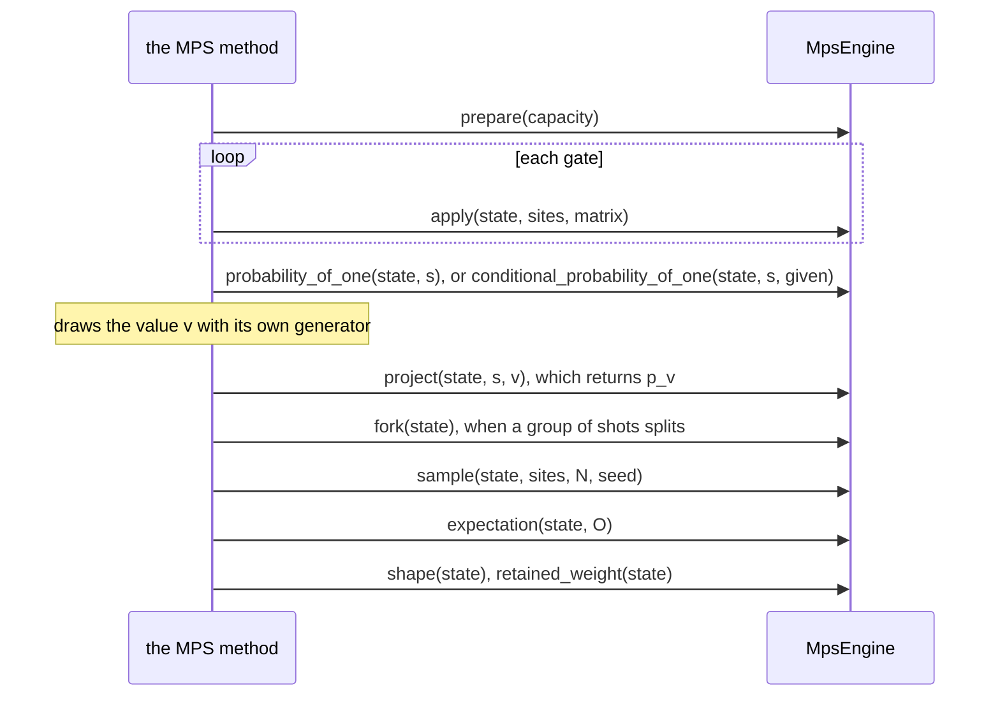

# The MPS engine contract

`tensornet` is the contract between a simulation method that runs matrix
product states (MPS) and the library that holds them.

## The problem

A simulator that runs a program as a matrix product state needs a library to
hold the chain of site tensors: one on the CPU, cuTensorNet on a GPU, each
with its own types, layouts and limits. Without a contract between them,
every simulator would speak each library's language, and each library would
answer the same question in its own way: which bit of a matrix is which
site, whether a read is normalized, what a truncation cost, which call is an
error. This crate states the contract once, in tensor terms only (sites,
matrices, probabilities and seeds), with an exact engine to check every other
one against.

## The approach

The crate states what a library does for a simulation method as one trait,
`MpsEngine`, in terms every MPS library shares; what one library needs stays
in its engine. So a method is written once, against the trait, and a new
library is a new engine, with no change to the method or to the other
engines. Each promise is stated once, in the rustdoc of the item that keeps
it: the contract an implementer reads in their editor. The refusal of a call
whose arguments break the contract is made once, by the functions of
`checks`, which every engine calls, so engines agree on it. An exact engine,
`ExactReference`, gives the answer every engine with enough bond must give,
so that an engine's answers can be checked against it.

The evidence is the crate's tests, in [`src/tests/`](src/tests/): the
reference's amplitudes are those of the QDK's sparse state simulator on
random circuits, and its chain has the Schmidt ranks a singular value
decomposition gives; and the checks of each method refuse each fault and
accept its edges.

## The model

- [`MpsShape`](src/shape.rs) is the shape of a chain, by the extents of its
  sites alone: the capacity a caller asks for, and the chain an engine
  holds. `MpsShape::qubit_chain(n, χ)` is the capacity of `n` qubits with
  bonds at most χ.
- [`MpsEngine`](src/engine.rs) is what a library that holds matrix product
  states does: prepare a state within a capacity, apply a unitary to sites,
  read the probability of a one at a site (also given earlier values),
  project, fork, sample sites for many shots from one seed, take the
  expectation of a Pauli sum, and report the chain it holds and the weight
  its truncations kept. It has no instructions, shots or random
  generators: the method that calls it draws its own values.
- [`Refusal`](src/refusal.rs) is why an engine refused a call whose
  arguments break the contract, the same on every engine; each engine's
  error exposes it through `MpsEngineError::refusal`. The functions of
  [`checks`](src/engine/checks.rs), one per method, make the refusals of the
  arguments.
- [`PauliSum`](src/pauli.rs) is the observable an engine reads, on sites.
- [`ExactReference`](src/engine/reference.rs) is a dense state vector of at
  most 20 sites that never truncates: the exact answer every engine with
  enough bond must give, within the limits its rustdoc states. It is for
  tests, not for simulation (feature `conformance`).

A Bell pair on the reference, read three ways (the crate's doctest in
[`src/lib.rs`](src/lib.rs), which every `cargo test` runs: the crate's
dev-dependency on itself enables the `conformance` feature for its tests):

```rust
use num_complex::Complex64;
use tensornet::reference::ExactReference;
use tensornet::{MpsEngine, MpsShape, Pauli, PauliSum, PauliTerm};

let (o, l, h) = (0.0, 1.0, std::f64::consts::FRAC_1_SQRT_2);
let c = |re| Complex64::new(re, 0.0);
let hadamard = [c(h), c(h), c(h), c(-h)];
// Row-major, `M[out][in]`, `sites[0]` the most significant bit.
let cx = [l, o, o, o, o, l, o, o, o, o, o, l, o, o, l, o].map(c);

let engine = ExactReference::new();
let capacity = MpsShape::qubit_chain(2, 2).expect("two sites form a chain");
let mut state = engine.prepare(&capacity)?;
engine.apply(&mut state, &[0], &hadamard)?;
engine.apply(&mut state, &[0, 1], &cx)?;

let p1 = engine.probability_of_one(&state, 1)?;
assert!((p1 - 0.5).abs() < 1e-12);

let zz = PauliTerm::new(c(1.0), vec![(0, Pauli::Z), (1, Pauli::Z)])?;
let zz = PauliSum::new(c(0.0), vec![zz])?;
assert!((engine.expectation(&state, &zz)? - c(1.0)).norm() < 1e-12);

let values = engine.sample(&state, &[0, 1], 100, 7)?;
assert!(values.chunks_exact(2).all(|shot| shot[0] == shot[1]));

assert_eq!(engine.shape(&state)?.max_bond(), 2);
```

The crate depends only on `thiserror` and `num-complex`, so it builds for
every target the QDK supports, WebAssembly included. The API reference is the
rustdoc (`cargo doc -p tensornet --open`), which states the contract;
[`design.md`](design.md) says why the crate is shaped as it is.

## The engine

The MPS method calls an engine like this; each call's contract is in its
rustdoc:



### The contract

Each method's rustdoc, in [`src/engine.rs`](src/engine.rs), states what it
requires, what it ensures, and which `Refusal` it makes; in brief, what each
is for:

- [`prepare`](src/engine.rs): a state of all zeros within a capacity.
- [`apply`](src/engine.rs): a unitary on one or more sites, laid out by the
  textbook convention.
- [`probability_of_one`](src/engine.rs): P(One) of a site, for the method to
  draw its value.
- [`conditional_probability_of_one`](src/engine.rs): P(One) of a site given
  earlier values, for many shots on one state without changing it.
- [`project`](src/engine.rs): keeps a drawn value, and returns its
  probability.
- [`fork`](src/engine.rs): an independent copy, for shots that split.
- [`sample`](src/engine.rs): the values of many shots, from one seed.
- [`expectation`](src/engine.rs): the expectation of a Pauli sum.
- [`shape`](src/engine.rs): the chain the engine holds now, what the run
  pays for.
- [`retained_weight`](src/engine.rs): the weight the truncations kept, what
  the approximation cost, and what it bounds.

A call whose arguments break the contract is refused, the same way on every
engine ([`src/refusal.rs`](src/refusal.rs),
[`src/engine/checks.rs`](src/engine/checks.rs)); any other error is the
engine's own failure. The module doc of
[`src/engine.rs`](src/engine.rs) says how the method draws values, and the
three ways' promises.

## Planned

- **`apply_kraus`**, a non-unitary operator (a Kraus operator of amplitude
  damping, for noisy simulation), of which `project` is the special case it
  generalizes. Until then `apply` refuses a matrix that is not unitary.
- **Grouped shots**, the case of `fork`: shots that share a state until a
  measurement splits them.
- **Reads for a debugger**, which every MPS library offers but no
  simulation method needs yet: the amplitude of a basis state, the reduced
  density matrix of a few sites, and the Schmidt values at a cut (or the
  entanglement entropy they give). A debugger that shows a state would
  need them.

## Files

| File                      | Defines                                                                                                                                   |
| ------------------------- | ----------------------------------------------------------------------------------------------------------------------------------------- |
| `src/lib.rs`              | the crate's public surface and its role                                                                                                   |
| `src/engine.rs`           | `MpsEngine`, what an engine does                                                                                                          |
| `src/engine/checks.rs`    | the argument checks of every method, which make every refusal but `ZeroProbabilityOutcome`                                                |
| `src/engine/reference.rs` | `ExactReference`, the exact engine, with `ReferenceState` and `ReferenceError` (feature `conformance`)                                    |
| `src/shape.rs`            | `MpsShape`, the shape of a chain, and `MpsShapeError`                                                                                     |
| `src/pauli.rs`            | `Pauli`, `PauliTerm`, `PauliSum` and `PauliError`: the observables of `expectation`                                                       |
| `src/refusal.rs`          | `Refusal`, why a call was refused, and `MpsEngineError`, how an engine's error exposes it                                                 |
| `src/tests/`              | the crate's tests, one file per module, in the same folders                                                                               |
| `design.md`               | why a chain is described by its extents, refusals versus failures, what libraries offer, the reference's arithmetic, and what is left out |
