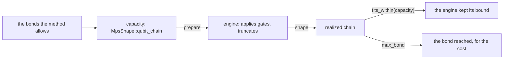

# The design of `tensornet`

Why the crate is shaped as it is. Each rule is stated in the rustdoc of the
item that keeps it, which this page cites rather than restates; the
[README](README.md) gives an overview.

## The shape of a chain

A chain of $n$ sites has a physical dimension $d_k$ at each site (the extent
of the site's own axis, drawn vertically) and a bond $\chi_k$ between sites
$k$ and $k+1$ (drawn horizontally); under each site is the order in which
`MpsShape::new` lists its extents:

$$
\begin{array}{ccccccc}
\text{site } 0 & \overset{\chi_0}{\text{———}} & \text{site } 1 & \overset{\chi_1}{\text{———}} & \cdots & \overset{\chi_{n-2}}{\text{———}} & \text{site } n-1 \\
\big\vert & & \big\vert & & & & \big\vert \\
d_0 & & d_1 & & & & d_{n-1} \\[1ex]
[d_0, \chi_0] & & [\chi_0, d_1, \chi_1] & & & & [\chi_{n-2}, d_{n-1}] \\
\text{rank } 2 & & \text{rank } 3 & & & & \text{rank } 2
\end{array}
$$

A lone site is $[d_0]$, of rank 1.

A chain that holds a state $\lvert\psi\rangle$ exactly needs, at cut $k$, a
bond of at least the Schmidt rank there,

$$\chi_k^{\text{exact}} = \operatorname{rank}\Psi^{(k)}, \qquad \Psi^{(k)}_{(b_0 \ldots b_k),\,(b_{k+1} \ldots b_{n-1})} = \psi_{b_0 \ldots b_{n-1}},$$

where $\psi_{b_0 \ldots b_{n-1}} = \langle b_0 \ldots b_{n-1} \vert \psi \rangle$
are the state's amplitudes, one index per site, and that rank is at most the
dimension of the smaller side,
$\min\big(\prod_{j \le k} d_j,\ \prod_{j > k} d_j\big)$. That bound is why
`MpsShape::qubit_chain` caps each bond by it: a capacity then asks for no more
than any state needs, and one capacity never truncates. `MpsShape::new`
accepts a larger bond all the same, because a shape is a description: any
line of positive extents whose neighbours agree is a chain.

`MpsShape::new` rejects a site whose element count overflows a machine word
when the chain is described (`MpsShapeError::ElementCountOverflow`), so that
every later element count is answered without an overflow check. Nothing in
the shape is specific to qubits, for the same reason: a qubit is the
engine's restriction, which it makes when it prepares a state
(`checks::prepare`), not the shape's.

### Capacity and realized chain

A method that runs an MPS uses `MpsShape` twice per state, once before and
once after the engine does its work:

- **Before:** the capacity is what the method asks for; an engine that
  allocates up front sizes its site buffers from `element_counts`, plus the
  transit bonds its routing needs, which the capacity does not bound: while
  a site moves across a cut, that cut may need up to twice the bond of a cut
  beside it (four at a cut capped at one between cuts of two).
- **After:** the realized chain is what `MpsEngine::shape` reports, the
  bonds the engine holds now, read back as the same type, so that one
  comparison, `MpsShape::fits_within`, tells an engine that kept its bound
  from one that did not, or from a state that outgrew a capacity the
  reference does not truncate to.

## Why a chain is a description of its own

A general tensor network can express a chain's topology (a line of nodes
sharing one index each) but not the invariants that make it a matrix product
state: that the sites form a line at all, that neighbours agree on the bond
between them, and that the two ends carry no outer bond. A general network
has nowhere to put those; `MpsShape` holds them. In the other direction a
chain cannot express an arbitrary topology, so if a general network is
described here, it is a peer of `MpsShape` rather than its supertype, and
neither loses its invariants.

The _sweep_ that builds a chain is a strategy and stays with the engine that
performs it. The _chain_ is a shape, and it is the shape callers reason
about: the bonds an engine holds, which is what the run pays for, and
whether they fit the capacity that was asked for.

## Extents, but never strides

A site is a list of extents, and deliberately nothing else. Strides (the
offsets used to walk a tensor laid out in a flat buffer) are a property of a
buffer, not of a state. `MpsShape` carries no elements, so it has no buffer,
and a layout with nothing to lay out is meaningless.

This matters in practice. An engine that truncates writes a tensor smaller
than the allocation it was handed, and reports the strides it actually used;
those strides belong to that one readout, in the code that fetched it. The
shape belongs to the state. Keeping them apart is what lets one type
describe both a capacity a caller requests and a shape an engine produced:
different values of one type, related by `fits_within`, rather than two
types that happen to hold the same numbers.

## Refusals are the contract's, failures the engine's

An engine's error type is its own, because each engine fails in its own ways
(a device error, a limit of its own). A call whose arguments break the
contract is another matter: it is a bug in the caller, and every engine must
say the same thing about it, or a program that runs on one engine fails
differently on another. That is why the refusals are the crate's
(`Refusal`), made in one place (`checks`, one function per method), and why
an engine's error holds one and displays as it (`MpsEngineError`). Which
refusal a call with several faults gets is unspecified (`Refusal`), so no
caller relies on it.

A refusal leaves the state unchanged, since the caller may go on; a failure
leaves it unspecified (`MpsEngine` states both), because no use case
continues after a device error (the simulation method fails the shot), so
asking an engine to undo a failed call halfway would cost every engine for
no caller.

## What every library offers, and what one needs

`MpsEngine` was checked against the MPS libraries a simulation method may
sit on (quimb, ITensor, TeNPy, Qiskit Aer's MPS, cuTensorNet, tensor4all):
what every one offers, in terms they share, belongs in the trait; what one
library needs belongs in its engine. So:

- `MpsEngine::sample` takes any `u64` seed; a library with a narrower range
  (cuTensorNet's is $1..=2^{31}-1$) has a need of its own, so its engine maps
  the seed into it.
- `MpsEngine::retained_weight` names the weight, not how it is held: a
  library may keep it as the norm of a state it never renormalizes
  (cuTensorNet), or apart from a state it renormalizes (TeNPy; ITensor when
  asked).
- `MpsEngine::apply`'s layout is the textbook convention, so a method writes
  its gates as printed; cuTensorNet's happens to match.
- `MpsEngine::project` computes the probability it divides by, so that no
  caller passes one that disagrees with the state; a library that takes it
  from its caller to save a contraction (cuTensorNet's state API) keeps
  that saving inside its engine.
- `MpsEngine::fork` copies the chain where the library can copy a state;
  where it cannot (cuTensorNet), its engine initializes a new state from
  the tensors it holds (`cutensornetStateInitializeMPS`).

**Planned:** reads that every library offers but no simulation method
needs yet: the amplitude of a basis state, the reduced density matrix of a
few sites, and the Schmidt values at a cut (or the entanglement entropy
they give). A debugger that shows a state would need them; they join the
trait with it.

## The reference's arithmetic

`ExactReference` does its own arithmetic, with no library beneath it, so its
answers do not depend on a library's version, and it runs wherever the crate
builds. The module doc of `src/engine/reference.rs` states its rules: why
its reads divide by $\langle\psi\vert\psi\rangle$ (a read that did not would
show the drift the unitarity tolerance allows as P(One) $> 1$), and, since
it squares amplitudes with no rescaling, the range of probabilities it
answers to rounding.

## What is deliberately not here

- **General networks and their contraction.** No indices, networks,
  contraction queries or plans. No simulation method in the QDK contracts a
  general network yet; the types arrive with the first one that does.

- **A shared algorithm.** `MpsShape` is a description, and `MpsEngine`
  states what an engine answers, not how it builds or truncates a chain:
  engines differ too widely there for a shared implementation to be
  discovered rather than invented.

- **Truncation settings.** Libraries express approximation in incompatible
  ways (a maximum bond and a discarded weight; an SVD algorithm with absolute
  and relative cutoffs plus a gauge option; none at all). A shared
  abstraction here would be invented rather than discovered, so each engine
  takes its own options. The capacity's bonds are the one bound every engine
  that truncates keeps.

- **Routing options.** An engine that moves sites to bring a gate's sites
  together chooses how; the trait has no parameter for it, and no answer
  shows it.

- **Vendor scalar types.** Extents are ordinary `usize` values, not
  cuTensorNet's `int32_t` and `int64_t`. The narrowing, and the overflow
  check that goes with it, belongs at the boundary with that library, where
  it is a constraint.
