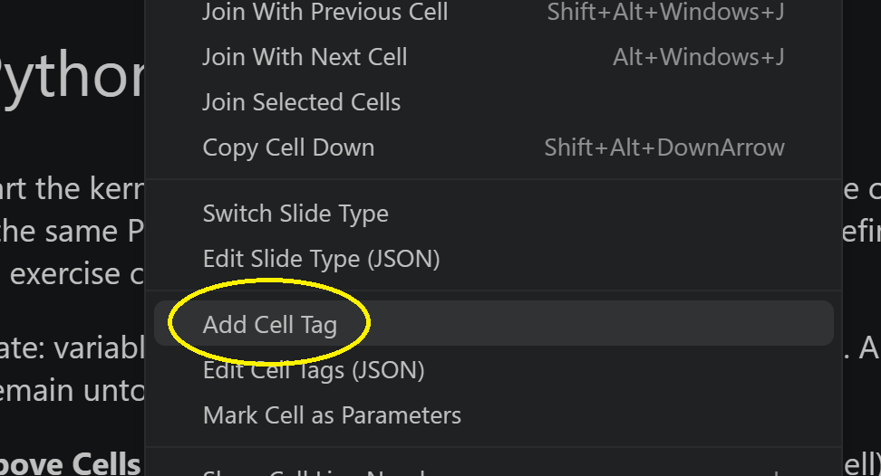
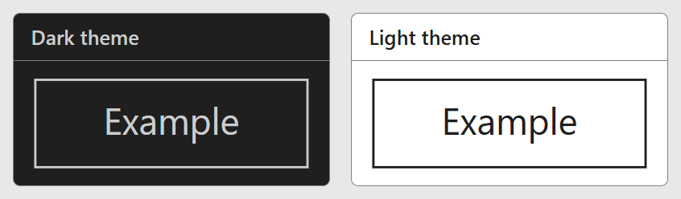

# Authoring a QDK Learning course

A QDK Learning course is a collection of Jupyter notebooks arranged in a particular folder structure with a few support files.

The structure described below is what we've implemented in our prototype but can easily be updated based on feedback.

For a concrete example, see the
[Chemistry QPE course](resources/qdk-learning/courses/chemistry-qpe).

## Structure

```
resources/qdk-learning/courses/
└── chemistry-qpe/           folder name is the course ID
    ├── course.json          course metadata
    ├── requirements.txt     python requirements for the notebooks
    ├── _course_lib.py       utilities for validating exercises
    ├── _check_env.py        checks the learner's setup against `environment.importChecks`
    ├── 00-overview/
    │   ├── _unit.py         unit-specific helpers (mostly exercise registration)
    │   └── overview.ipynb   unit content (author copy)
    └── 01-energy-and-accuracy/
        ├── _unit.py
        └── energy_and_accuracy.ipynb
```

Bundled courses live under the extension's `resources` folder.
A course can also be authored in a workspace under `qdk-learning/courses/`, which is where the extension copies bundled courses the first time a learner opens one.

`_course_lib.py` and `_check_env.py` contain utilities that you may find helpful, but aren't required. You can use the ones from an existing course as models.

_Note_: The folders in this example are numbered, but that's not required - the display order comes from `course.json`

## course.json

```json
{
  "schemaVersion": 1,
  "title": "Ground-State Molecular Energies with QPE",
  "shortDescription": "Estimate a molecule's ground-state energy using quantum phase estimation.",
  "units": [
    { "id": "overview", "title": "Tutorial Overview", "dir": "00-overview" },
    {
      "id": "energy-and-accuracy",
      "title": "Energy and Accuracy",
      "dir": "01-energy-and-accuracy"
    }
  ],
  "environment": {
    "importChecks": ["qdk_chemistry"]
  }
}
```

- `schemaVersion`: set to `1`.
- `title`: Display name of the course.
- `shortDescription`: Simple help/alt text about the course.
- `units`: An ordered list of units and where to find each.
- `environment.importChecks`: Optional. A list of imports that `_check_env.py` verifies before a unit starts.

## Exercises

Exercises are one of the main value-adds of the QDK Learning courses.
You can tag individual code cells as exercises and associate hints, solutions, and explanations with them.
Each exercise also has associated validation logic to tell a learner whether their solution is correct.
Progress reflects learner code cells, not just the cells tagged as exercises.
Each quiz cell contains one question and is one activity, complete after a
correct checked answer. Running its cell alone does not grant completion.
Cells tagged `author-only` are not progress activities.

An exercise code cell is preceded by a markdown cell giving the name of the exercise (as a header) and a brief description of what's to be accomplished.
The exercise code cell itself is tagged `exercise` using the `Add Cell Tag` functionality in VS Code (or by editing the JSON directly).

<div align="center">
  
</div>

The exercise code cell may optionally be followed by cells tagged `hint`, `solution`, or `explanation`, and there can be more than one of each.
`solution` goes on a code cell; `hint` and `explanation` go on markdown cells.
The contents of these cells will be available to the Copilot Agent guiding the learner, but not to the learner themselves.

## Exercise Validation

An exercise will generally take the form of an empty function with an `@exercise` decorator.
It will be the learner's job to fill in the function body.

```python
from _unit import exercise


@exercise
def forty_two():
    # ========================================================================
    # YOUR TASK: change the expression below so forty_two() returns 42.
    # ========================================================================
    return qsharp.eval("0")  # <-- edit this expression
```

In `_unit.py`, each exercise in the unit is "registered" by name, along with an associated validation function.
(There are some pre-rolled validation functions for things like asserting the output has a particular scalar value.)
When the cell is executed, the decorator will look up the validation function, run the student's implementation, and apply the validation logic.

```python
import sys
from pathlib import Path

_course_root = str(Path(__file__).resolve().parent.parent)
if _course_root not in sys.path:
    sys.path.insert(0, _course_root)

from _check_env import check as check_env  # noqa: E402, F401
from _course_lib import exercise, register_value_exercise  # noqa: E402, F401

ANSWER = register_value_exercise("forty_two", expected=42)
```

The `sys.path` preamble is what lets the notebook import `_course_lib.py` from the course root.
`register_value_exercise` covers the common case of checking the return value.
Use `register_exercise(name, validate, ...)` when a unit needs its own checking; `validate` returns an error message when the answer is wrong and `None` when it's right.

When validation fails, `_course_lib` shows the message and raises, so the cell errors out.
Once the cell runs successfully, the exercise will be considered to be complete.

## Quizzes

A quiz is a multiple-choice question the learner answers in the cell output.
It is a self-check with retryable feedback. Each quiz cell appears once in the
learning tree with a numbered label, such as "Quiz 6.1", "Quiz 6.2".
The unit number uses a leading directory number (for example `06-...`) when
present, otherwise its 1-based position in `course.json`. Quizzes are numbered
in notebook order.
Answering saved quiz outputs requires no running kernel.

Import `quiz` in the notebook's setup cell:

```python
from _unit import quiz
```

Write the full question in a dedicated author notebook code cell tagged `quiz`:

```python
quiz(
    "grid-spacing",
    prompt="Which control changes the energy-grid spacing?",
    options=[
        ("bits", "The number of phase bits", True, "It sets how finely the interval is discretized."),
        ("shots", "The number of shots per bit", False, "More shots stabilize each bit; spacing is untouched."),
        ("space", "The size of the active space", False, "That changes the Hamiltonian itself."),
    ],
)
```

Each option is `(id, text, correct, explanation)`.
An explanation is shown for the options the learner picked, and for the rest once they answer correctly — a wrong attempt never reveals an option they didn't choose, so there is something left to try again for.
Write each one as the reason that option is right or wrong rather than as a hint.
A single-select question needs exactly one correct option, and ids must be unique; anything else raises when the cell runs, so mistakes surface while you're authoring.

For a question with several right answers, pass `multi_select=True`:

```python
quiz(
    "ancilla-traits",
    prompt="Which of these are true of the readout ancilla?",
    options=[
        ("h-gates", "It receives the H gates and the feedback rotation", True, "That is what puts it in superposition."),
        ("controls", "It controls the Hamiltonian evolution", True, "The controlled-unitary hangs off this wire."),
        ("state", "It holds the prepared molecular state", False, "The compute register does that."),
    ],
    multi_select=True,
)
```

The learner then gets checkboxes and an explicit "Select all that apply", and has to find every correct option to pass.
A multi-select question needs at least two correct options and at least one incorrect one — a "select all that apply" with a single answer teaches learners to distrust the instruction, and one where everything applies can't be answered wrongly.

Options are shuffled, seeded from the quiz id.
It's natural to write the correct answer first, which would otherwise make "always pick A" a winning strategy across a unit.
The order is stable, so re-running the notebook doesn't reshuffle or produce a spurious diff.

Keep each quiz cell limited to one standalone `quiz(...)` call and comments.
Arguments must be literal data: use strings, lists/tuples, and booleans rather
than variables, function calls, or computed expressions. Write the first
argument as a plain single- or double-quoted ID, not a prefixed, escaped,
triple-quoted, or concatenated string. Whitespace, multiline calls, and comments
around that ID are supported. Put adjacent questions in separate code cells.

Bind the notebook once in `_unit.py`, after its course-root import preamble:

```python
from functools import partial
from pathlib import Path

from _learning_output import (
    quiz_for_notebook,
    validate_quizzes as _validate_quizzes,
)

_notebook = Path(__file__).resolve().with_name("my_unit.ipynb")
quiz = quiz_for_notebook(_notebook)
validate_quizzes = partial(_validate_quizzes, _notebook)
```

This binding covers every question in the notebook; adding a question needs no
new helper registration. Question content stays in the author notebook.

Materialization extracts only the plain quoted name at the start of the supported
authoring form, then replaces the definition with a named call such as
`quiz("grid-spacing")`. It does not interpret the rest of the Python definition,
execute cells, or bake outputs. Saved outputs are preserved when available;
missing outputs do not block workbook creation. On execution, the bound helper
reads the saved author source and displays that question.

Quiz activity identity is the stable notebook cell ID, like an exercise.
Tree numbering is presentation only; the readable caller still uses the
authored question ID, independently of the cell's internal ID. Clicking the
activity opens that cell.
Its `quiz` tag also lets subsequent code cells find their section heading.

The activity catalog reads tags, stable cell IDs, and the quoted question name
from source, not saved quiz outputs. Answer
checking uses the current learner cell's validated MIME payloads, including new
outputs generated by rerunning the cell. Author definitions remain the maintained
source; outputs are generated question snapshots.

Successful quiz cells are recorded in the existing workspace progress file.
Completion requires the cell's single valid question output to be answered
correctly. Incorrect answers do not grant completion or revoke earlier
completion. Clearing outputs, running a quiz cell, retrying, or reopening the
notebook does not clear earned completion. Resetting the unit clears completion
along with other unit progress.

This is self-paced progress, not a secure assessment: learner-controlled notebook
payloads supply the answer key. The extension validates their shape and checks
selected IDs itself, but does not prevent a learner editing those payloads or
the progress file. Copilot actions still send only bounded identifiers, not
notebook prose or commands.
The answer controls and feedback currently start fresh when an output is
re-rendered: completion persists, but restoring the last checked selection is
not yet supported.

Quiz ids and option ids are lowercase letters, digits and hyphens, up to 64 characters.
An invalid ID fails when you run the cell: those ids are the only thing the renderer's Copilot action sends to the extension, so a shape it can't accept would leave that button doing less than it should.

A question needs text, and so does every option.
The renderer refuses to draw a payload missing either, so constructing one fails when you run the cell rather than baking cleanly and showing a learner an error.

### Author validation

Before publishing a quiz notebook, save it and run a final code cell tagged
`author-only`:

```python
# Save this notebook first: validation reads the saved file, not unsaved edits.
from _unit import validate_quizzes

validate_quizzes()
```

This reuses the quiz validators to check definitions, unique quiz IDs, option
counts, correct-answer configuration, one question per cell, plain quoted ID
spelling, and quiz-cell tags. It also reports
standalone Python `quiz(...)` calls missing the `quiz` tag. Use that direct call
form, not aliases or wrapper functions. Question-data errors identify the quiz ID
from its saved definition and the 1-based notebook cell number. Whole-cell role
or kind errors and unidentifiable definitions use the cell number alone.
Cell numbers count all notebook cells, not execution order.
Success prints a quiz count.
The check never executes notebook cells, refreshes outputs, or writes the file.
It does not prove that the educational content is correct.

`author-only` marks notebook-level author tooling or notes. Unlike `hint`,
`solution`, and `explanation`, it is not associated with an exercise. The cell,
including any outputs, is removed from learner workbooks and excluded from
activities. Do not tag learner quiz cells `author-only`.

The content-role tags `exercise`, `quiz`, `hint`, `solution`, `explanation`, and
`author-only` are mutually exclusive. Modifier tags such as `skip-test` and
`section:...` may accompany a role. Quiz validation checks conflicting quiz roles
before parsing definitions; repository notebook tests and the course verifier
check role conflicts across all cells, including exercises.

`skip-test` skips cell execution in notebook tests, not the structural validation
of saved quiz definitions by the final author check.

Repository notebook tests require this final validation cell for quiz-bearing
notebooks and execute it as ordinary author code. Do not tag it `skip-test`.
Running an individual author quiz cell checks its data, but does not replace
the notebook-wide validation step.

### Saved quiz outputs

To publish questions visible before execution, run their cells and save the
notebook, or use the quiz-baking utility. Validation alone does not create saved
outputs. Keep output freshness separate from structural validation.

For the chemistry course, `utils/chemistry-qpe/details_to_quiz.py` does that baking for a whole chapter, and re-bakes it when a question's wording or options change:

```
python details_to_quiz.py 06-iterative-phase-estimation --check   # report drift, write nothing
python details_to_quiz.py 06-iterative-phase-estimation           # re-bake what changed
```

`--check` catches a saved definition edit that never reached the displayed output,
including a removed question whose old output remains. The utility only refreshes
quiz outputs; it does not execute the notebook or change author source.

The answers are in the saved cell output, because grading happens in the renderer without a kernel.
This keeps them out of the cell source the learner reads, which is the same protection the collapsible-answer style gave; it isn't a guarantee against a determined learner opening the `.ipynb`.

## Editing a published course

Progress is tracked per cell, using the notebook's nbformat cell IDs.
Editing a cell's text is safe, but deleting a cell and adding a replacement gives it a new ID, so the old completion no longer matches.

The extension copies a bundled course into `qdk-learning/courses/` the first time a learner opens it, and skips the copy if that folder is already there.
So a learner who has already started the course won't pick up your changes when the extension updates - not even by resetting a unit, because reset rebuilds the working copy from the course copy already in their workspace.
Your changes reach learners who haven't started the course in that workspace yet; anyone else has to delete the course folder first.

When the course isn't bundled - say, one the learner cloned from a repo - they update the course copy themselves, so they'd pull your changes and then reset the unit to rebuild the working copy from them.

Where possible, prefer inline SVG over embedded images, because an SVG can adapt to the learner's UI theme.
An attachment is rendered as an ``, which cannot read the notebook's stylesheet, so a light-background diagram stays light in a dark theme.
Putting the SVG markup directly in a markdown cell keeps it in the notebook's own DOM, where it can pick up `var(--vscode-*)` colours:

<!-- prettier-ignore -->
```html
<svg viewBox="0 0 120 40" role="img" aria-label="Example"><rect x="1" y="1" width="118" height="38" fill="none" stroke="var(--vscode-editor-foreground)"/><text x="60" y="25" text-anchor="middle" fill="var(--vscode-editor-foreground)">Example</text></svg>
```

The same SVG adapts its foreground to dark and light editor themes:

<div align="center">
  
</div>

Keep the markup on a single line - if it spans multiple lines, markdown splits it into separate paragraphs and it won't render.
Non-SVG images must be embedded as base64-encoded text.

## Environment

Setting up a Python environment can be tricky for new users and we want the focus to be on the course content, so we've added some helper functionality around installing and validating dependencies.

- The `QDK: Create a Microsoft Quantum Python virtual environment` command sets up an environment and prompts for the packages to install; the list it offers is specific to what QDK courses tend to need. If it already includes the packages you need, you can direct learners to the command palette for virtual environment setup.
- `course.json` lets you list imports you expect to work so they can be checked before the learner starts the unit (e.g. in case the learner selected the wrong notebook kernel), which the course's `_check_env.py` reads
- The course infrastructure depends on the Python and Jupyter VS Code extensions, so the learner will be prompted if those are absent

## Trying it out

Open a workspace folder in VS Code and navigate to the Microsoft Quantum extension panel (indicated by a Mobius strip).
If you've never used it before, it'll offer you a `Start Learning` button.
Use `Switch Course` in the tree view to select your new content.
Progress lives in `qdk-learning.json` at the workspace root: the current position, which activities are complete, the Python environment chosen per course, and whether a course has been picked yet.

When you switch to your course, temporary working copies of all the notebooks will be created (indicated by the `.workbook.ipynb` file extension).
These copies omit all the exercise hints, solutions, explanations, and `author-only`
cells and give the learner a notebook they can edit freely without worrying about
overwriting anything important.
If the working copy is already present, it won't be overwritten the next time the course is loaded, so if you based your course on a sample you'd previously run, delete any leftover `*.workbook.ipynb` files first.
Resetting a unit does overwrite that unit's working copy.
To return to the first-run state, delete `qdk-learning.json` and all `*.workbook.ipynb` files.

There are buttons and context menu items throughout the UI that connect the experience to the Copilot chat.
Exercises, in particular, offer hints and explanations.
Copilot's responses will be informed by the hints, solutions, and exercises provided in the original notebook.
