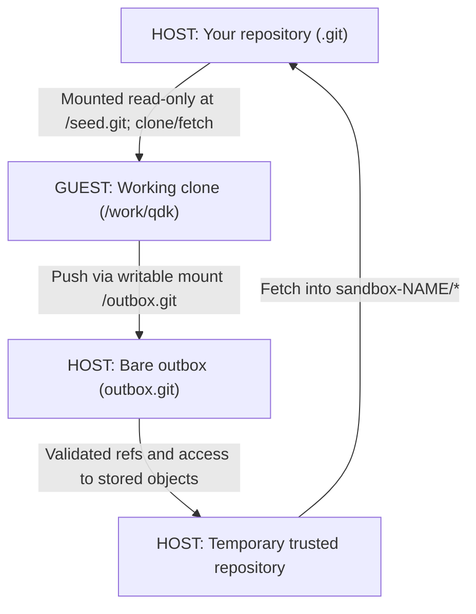

# QDK Copilot sandbox

Tooling for running the Copilot CLI in a sandbox container.
The sandbox provides safeguards intended to make the risk level of using `copilot --allow-all` acceptable, but it's not foolproof - see below.

## Safeguards

### Networking

All networking goes through a proxy with a domain allowlist.
(You can locally supplement the allowlist according to your risk tolerance without rebuilding the image.)
The `web_search` tool is blocked because it actually makes a safe-looking API call and then GitHub performs a Bing search and returns results that aren't subject to the allowlist.

One consequence of this network filtering is that you can't reach pypi, npm, etc.
For this reason, the dependencies required to build `--qdk` are built into the image.

### Git

In order to be able to have Copilot work on unpublished branches, the container read-only mounts your local `.git` folder (`/seed.git` and remote `seed` in the container).
It works from its own clone (`/work/qdk`), which won't include any of your uncommitted work.

In order to be able to expose the work Copilot has done, the container mounts a read-write clone (`~/qdk-copilot-sandbox/NAME/outbox.git`).
Its branches will be available as `sandbox-INSTANCENAME/*` tracking branches in your local clone, which will be updated at the end of a session or on explicit `sandbox.py fetch`.
For added security, the host pauses or stops the agent and creates a temporary, host-configured view of the outbox’s branches and objects.
Your local repository fetches from this view rather than directly from the agent-writable outbox, avoiding its potentially malicious Git configuration.



### Files

For convenience, you can provide files to the container (read-only) via the `to_copilot` folder and read output via the (read-write) `from_copilot` folder.
Strictly speaking, you should treat `from_copilot` as an untrusted folder (i.e. opened in a separate VS Code workspace not marked Trusted), but you may decide you're comfortable having it within the repo for convenience.
This is chiefly useful for getting quick access to generated markdown reports without a lot of git pushing and pulling.
The sandbox makes a best-effort attempt to strip symlinks and local git repos out of the `from_copilot` folder.

The default mounts are `exchange/INSTANCE_NAME/to_copilot` (read-only context) and
`exchange/INSTANCE_NAME/from_copilot` (writable output). Use `--to-copilot-dir PATH` and
`--from-copilot-dir PATH` to relocate them.

### Accounts

The container runs as a non-root user and `sudo` is unavailable.

### Tokens

The container is powered by a GitHub fine-grained PAT, preferably with only `Public Repositories` and `Copilot Requests - Read` permissions.
It has no access to your personal GitHub token or OS/domain credentials.

### Known Loopholes

1. `web_search` is blocked by a hook, but the agent has a token and can make a REST request directly.
   It's relatively safe, since following any of the returned links still goes through the proxy (though summaries can still contain injected prompts).
1. Every public repo on GitHub is reachable, which almost certainly includes a bunch of prompt injection.

Since the code is already public (modulo local branches), the main risk is exfiltration of the fine-grained PAT, which should be short-lived and low-permission.
There can also be private configuration and history data in `.git`.

## Prerequisites

- Python 3.10 or newer. Use this checkout's `.venv` interpreter when available.
- Docker Engine 28 or newer, Linux containers, and the Docker Compose v2 plugin with `compose run --pull` support.
  Windows/macOS need a recent Docker Desktop Linux engine.
  The launcher checks the server, not just the client.
- Git; 2.45.1 or newer is recommended and older versions get a warning.
  It contains some security fixes related to nested .git folders.
- For published images only: Docker Buildx and Azure CLI with permission to pull from the team's `qdkacr` registry.
  The launcher offers `az acr login --name qdkacr` when registry access fails.
  Locally built images launched with `--dev` do not need ACR access.
- A secret store: initialized `pass` plus GnuPG on Linux, unlocked Keychain (`security`) on macOS, or current-user DPAPI on Windows.
- On Linux, host bind mounts must be readable/writable by container uid 1000 as appropriate.
  Docker Desktop must be allowed to share the checkout and instance directory.
  The launcher does not change host ownership or ACLs.

Images must first be published by the separate image pipeline or built with the maintainer tool.
This launcher does not install prerequisites.
Docker's daemon is a trusted host service; rootless/remote-daemon networking and file sharing are not certified by these unit tests.

## Setup

### Providing a Token

```sh
.venv/bin/python tools/copilot-sandbox/sandbox.py set-token
```

It will offer to open github.com to a filled-in fine-grained PAT template.
You can decline and provide your own, if you prefer.

Windows and macOS store the token in DPAPI and the Keychain, respectively.
For Linux, see below.

#### Linux Secret Store Setup

On Linux, you'll need to manually set up a place to store the token.

Run these commands yourself on the host, as the same user who will run the
launcher. Skip key creation if you already have a suitable GPG key.

1. Install GnuPG and `pass` using your distribution's package manager. On Ubuntu/Debian:

```sh
sudo apt-get install gnupg pass
```

1. List your existing secret keys and their fingerprints:

```sh
gpg --list-secret-keys --fingerprint
```

1. If no suitable key appears, create one.
   Follow the prompts to choose a key, enter your name and email, and set a passphrase.
   Then list the keys again:

```sh
gpg --full-generate-key
gpg --list-secret-keys --fingerprint
```

1. Find the long hexadecimal fingerprint directly below the key's `sec` line.
   Replace `YOUR_GPG_KEY_FINGERPRINT` below with that entire fingerprint, without spaces.
   This configures `pass` to encrypt entries for that key:

```sh
pass init YOUR_GPG_KEY_FINGERPRINT
```

### Launching

**Don't run Docker Compose directly.**

First, start Docker Desktop and login to ACR:

```sh
az acr login --name qdkacr
```

Then, from the repository root:

```sh
.venv/bin/python tools/copilot-sandbox/sandbox.py run
```

The default command is `copilot --allow-all`.
You can pass your own after `--`, for example `copilot --resume=SESSIONID --allow-all`.
The `--` separator is required for custom commands; put all sandbox options, including `--instance`, before it.

You may find it convenient to launch a bash prompt in the same session:

```sh
.venv/bin/python tools/copilot-sandbox/sandbox.py shell
```

### Local Allowlist

The local allowlist goes in `~/qdk-copilot-sandbox/NAME/allowlist.local.txt` with one domain per line.
Relaunch the container to pick up changes.

## Images

Image definitions live in `.ado/images/sandbox-agent` and `.ado/images/sandbox-proxy`.
The publishing pipeline is `.ado/images/build-sandbox-images.yml`.

### Pre-built

The default images are:

```text
qdkacr-cfgqhwddajdaebhg.azurecr.io/copilot-sandbox/agent:latest
qdkacr-cfgqhwddajdaebhg.azurecr.io/copilot-sandbox/proxy:<agent-build-id>
```

`--tag BUILD_ID` selects another published tag.
Only builds from `main` publish `latest`; use an explicit build ID for feature-branch images.
The launcher resolves the architecture-specific agent/proxy pair from registry metadata before downloading image layers.
It asks once for any required downloads, pulls those images in parallel by immutable digest, and pins the session to the selected local image IDs.
There is no download prompt when both images are already available locally.
Declining downloads uses the existing matching cached pair, or fails if that pair is unavailable.
If registry inspection fails, using a cached pair requires explicit confirmation. Authentication retries can prompt separately.
The agent's `qdk.copilot-sandbox.build-id` label selects the proxy tag, and both labels must match.
The proxy's `latest` tag is never used for pairing.

### Local (Public Feeds)

Local images can be built without using any Microsoft-internal resources.

```sh
DOCKER_BUILDKIT=1 .venv/bin/python tools/copilot-sandbox/build_images.py build --package-source public
```

By default, it will build (and thus, pre-download dependencies) for only the QDK (e.g. not VS Code).

If you want to support more or less of the repo, you can pass your own build arguments:

```sh
DOCKER_BUILDKIT=1 .venv/bin/python tools/copilot-sandbox/build_images.py build --package-source public -- --vscode --npm --wasm
```

After the build succeeds, launch Copilot:

```sh
.venv/bin/python tools/copilot-sandbox/sandbox.py run --dev
```

The build tool produces `copilot-sandbox-agent:dev`, `copilot-sandbox-proxy:dev` and additional build-id pairing tags.
The launcher selects the local agent and its matching build-id-tagged proxy.
Keep those pairing tags; the two `:dev` tags alone are not sufficient.
`run --dev --tag TAG` selects another local agent tag.

`--dev` does not inspect the registry, pull images, or build missing images.
Without it, the launcher checks the published ACR images even if local `:dev` images exist.
The launcher uses the selected agent/proxy pair directly and does not build per-instance custom images.

### Local (Internal Feeds)

To mimic the pipeline build locally, you need to pass a lot more arguments:

```sh
.venv/bin/python tools/copilot-sandbox/build_images.py build \
  --package-source azure \
  --secret-file npmrc=/secure/sandbox.npmrc \
  --secret-env msrustup_access_token=SYSTEM_ACCESSTOKEN \
  --secret-env pip_index_url=PIP_INDEX_URL \
  --toolchain-feed "$TOOLCHAIN_FEED" \
  --crates-feed "$CRATES_FEED"
```

- The installer is checked in at [.ado/images/install-msrustup.sh](../../.ado/images/install-msrustup.sh).
  It is supplied automatically from committed `HEAD`.
- `sandbox.npmrc` is constructed from the npm feed URI from Azure Artifacts and a token from `artifacts-npm-credprovider`.
- `SYSTEM_ACCESSTOKEN` comes from `azureauth ado token`.
- `PIP_INDEX_URL` is the pip feed URI from Azure Artifacts with an embedded token.
- `TOOLCHAIN_FEED` and `CRATES_FEED` you can copy from the pipeline variables on our release pipeline.

**Local authentication tokens are very short-lived.**

## Persistence and Instances

`--instance NAME` defaults to `default`. Names are 1-40 lowercase letters, digits, hyphens or underscores, starting with a letter or digit.
Windows device names such as `con` and `nul` are reserved on every platform.
Each instance has its own Compose project `qdk-copilot-sandbox-NAME`, proxy, networks, work volume, Copilot home volume, PAT, outbox and settings.

Host state lives in `~/qdk-copilot-sandbox/NAME/` outside the checkout.
The directory is mode 0700 on POSIX; config/token files are atomically written with mode 0600.
On Windows, directory access follows the user's inherited profile ACLs and DPAPI additionally binds the token to the user.
Symlinks and Windows reparse points are refused in state and mount paths.
Reusing an instance from another checkout warns and updates the remembered checkout; its work clone is preserved and subsequent fetches use the newly mounted seed.

- `config.json`: last checkout, exchange locations, saved CPU/memory limits and image selection.
- `allowlist.local.txt`: additional domains, one per line, optional `#` comments.
  This non-secret file is mode 0644 so Squid can read the bind mount.
- `outbox.git`: container-writable bare repository containing sandbox commits.
- `token.dpapi`: Windows only; other platforms store the PAT in their secret store.

CPU/memory limits apply for one launch unless `--save` is supplied. `0` means unlimited; examples are `--cpus 2.5 --memory 8g`.
`--save` also remembers the image source and tag. Without explicit image options, later launches use that saved selection.
Use `--registry` to override a saved local-image preference; switching image sources resets the tag to that source's default unless `--tag` is supplied.
Exchange relocations are saved when launching successfully far enough to configure the stack.

Different instances can run at the same time, with at most one active session per instance.
An OS-held per-instance lock prevents duplicate launches, including while the launcher is starting or waiting for input.
Agent container names and running-agent checks are scoped to the selected instance.
Host Git configuration updates are briefly serialized; this does not lock other instances for the duration of a session.
