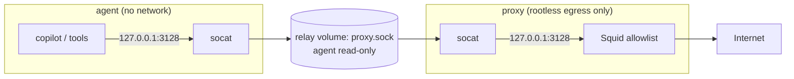
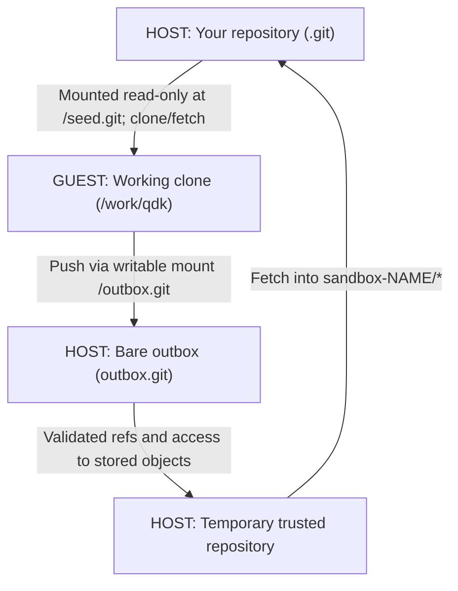

# QDK Copilot sandbox

Tooling for running the Copilot CLI in a sandbox container.
The sandbox provides safeguards intended to make the risk level of using `copilot --allow-all` acceptable, but it's not foolproof - see below.

## Warnings

More details below, but summarizing here for the TL;DR.

1. Any output from the sandbox has to be treated as untrusted - both branches and loose files.
   1. Be particularly careful with scripts it provides for local repros.
   2. By default, the loose files it creates are available within the repo itself, which VS Code typically considers trusted. If you're doing something risky, update your configuration to put them in an untrusted folder.
2. The sandbox infrastructure is in the same repo the sandbox has access to - only run the infrastructure from a trusted branch, preferably `main`.
3. State is preserved session over session in Podman volumes. If you work on something sensitive, you may wish to wipe them (or create a new instance).
4. Never open `outbox.git` or, on Linux, the `_work` volume with Git, a Git-aware shell prompt or an editor; they contain agent-controlled Git configuration. Use `sandbox.py fetch`.
5. On Linux, a container escape runs as you on your host; Windows and macOS add a VM boundary.
6. A sandbox makes `--allow-all` safer, not safe.

## Safeguards

### Networking

All networking goes through a proxy with a domain allowlist.
The agent container has no network interface except loopback.
Its main process is a `socat` relay from `127.0.0.1:3128` to a Unix socket on a small volume that it mounts read-only.
The proxy container creates that socket and forwards it to Squid, which listens only on the proxy's own loopback.
Only the proxy has egress, through its own IPv4-only rootless network, and it's removed when the session ends.



Squid refuses destinations that resolve to loopback, private or link-local addresses, which include your machine and its local services.

Before starting the workload, the host verifies the actual container configuration, including the exact set of mounts and devices as the kernel sees them.
It also checks kernel privilege and seccomp restrictions, and probes that:

- the agent has only loopback and can't open hypervisor (vsock) sockets or create user namespaces;
- protected mounts reject writes and direct connections fail;
- Squid answers through the relay and refuses forbidden destinations, including allowlisted probe names that resolve to loopback and to your machine.
  Verification failure prevents the workload from starting.
  Shell access is also refused until that container has passed verification.
  (You can locally supplement the allowlist according to your risk tolerance without rebuilding the image.)
  The `web_search` tool is blocked because it actually makes a safe-looking API call and then GitHub performs a Bing search and returns results that aren't subject to the allowlist.

One consequence of this network filtering is that you can't reach pypi, npm, etc.
For this reason, the dependencies required to build `--qdk` are built into the image.

### Git

In order to be able to have Copilot work on unpublished branches, the container read-only mounts your local `.git` folder (`/seed.git` and remote `seed` in the container).
It works from its own clone (`/work/qdk`), which won't include any of your uncommitted work.

The image also includes a clone of `microsoft/qdk-chemistry`, without building it.
On first use, startup copies that checkout into `/work/qdk-chemistry`; no network access is needed.
This ordinary clone has no seed or outbox integration, and later launches leave it unchanged.

In order to be able to expose the work Copilot has done, the container mounts a read-write clone (`~/qdk-copilot-sandbox/NAME/outbox.git`).
Its branches will be available as `sandbox-INSTANCENAME/*` tracking branches in your local clone, which will be updated at the end of a session or on explicit `sandbox.py fetch`.
For added security, the host pauses or stops the agent and creates a temporary, host-configured view of the outbox’s branches and objects.
Your local repository fetches from this view rather than directly from the agent-writable outbox, avoiding its potentially malicious Git configuration.



### Files

For convenience, you can provide files to the container (read-only) via the `to_copilot` folder and read output via the (read-write) `from_copilot` folder.
Strictly speaking, you should treat `from_copilot` as an untrusted folder (i.e. opened in a separate VS Code workspace not marked Trusted), but you may decide you're comfortable having it within the repo for convenience.
This is chiefly useful for getting quick access to generated markdown reports without a lot of git pushing and pulling.
The sandbox makes a best-effort attempt to strip symlinks and local git repos out of the `from_copilot` folder.

The default mounts are `exchange/INSTANCE_NAME/to_copilot` (read-only context) and
`exchange/INSTANCE_NAME/from_copilot` (writable output). Use `--to-copilot-dir PATH` and
`--from-copilot-dir PATH` to relocate them.

### Accounts

The container runs as a non-root user and `sudo` is unavailable.
Containers run under rootless Podman, so no sandbox process is root on the machine running Podman (on Linux, your host).
The agent's user maps to your account, so its outbox and exchange writes are owned by you; nothing in the proxy maps to your account.

Podman's default seccomp profile is more permissive than Docker's: it lets containers create user namespaces, a common first step in kernel exploits, and open vsock sockets to the hypervisor.
The launcher therefore applies [`seccomp.json`](seccomp.json), Docker's default profile from [moby/profiles](https://github.com/moby/profiles/blob/2ab3e516a3b49550c35b5e4511a0a7d136a02c8d/seccomp/default.json) (Apache-2.0), and verification confirms its effect.
The profile is an unmodified copy; see the [third-party notice and license](../../NOTICE.txt).

### Tokens

The container is powered by a GitHub fine-grained PAT, preferably with only `Public Repositories` and `Copilot Requests - Read` permissions.
It has no access to your personal GitHub token or OS/domain credentials.
The launcher delivers the PAT only after verification passes, over `podman exec` stdin into a mode 0400 file on the agent's memory-backed `/tmp`.
It never appears in a command line, the container's configuration or environment, or on disk (memory can still be swapped).

### Known Loopholes

1. `web_search` is blocked by a hook, but the agent has a token and can make a REST request directly.
   It's relatively safe, since following any of the returned links still goes through the proxy (though summaries can still contain injected prompts).
1. Every public repo on GitHub is reachable, which almost certainly includes a bunch of prompt injection.
1. The agent's output goes straight to your terminal, and escape sequences can, for example, set your clipboard.
   Consider disabling clipboard access by programs in your terminal's settings.
1. A container escape (a kernel or Podman bug) lands here:

   | Host    | Lands as                                            | Can reach                                   |
   | ------- | --------------------------------------------------- | ------------------------------------------- |
   | macOS   | the machine's user, in its VM                       | this checkout and `~/qdk-copilot-sandbox`   |
   | Windows | the machine's user, in the VM all WSL distros share | every drive, writable as you                |
   | Linux   | you, on your host                                   | everything you can, with unfiltered network |

   On Linux, consider running the sandbox as a separate local user.
   Rootless Podman applies no AppArmor profile, so Ubuntu and Debian hosts lack that layer; Fedora and RHEL still apply SELinux.

Since the code is already public (modulo local branches), the main risk is exfiltration of the fine-grained PAT, which should be short-lived and low-permission.
There can also be private configuration and history data in `.git`.

## Prerequisites

- Python 3.10 or newer. Use this checkout's `.venv` interpreter when available.
- Rootless Podman 6 or newer with cgroup v2 (5.x doesn't play nicely with cgroups in WSL 3).
  On Linux, the launcher uses Podman directly; your account needs `/etc/subuid` and `/etc/subgid` ranges.
  On Windows and macOS, it uses a dedicated Podman machine (see [Podman Machine](#podman-machine-windows-and-macos));
- Git; 2.45.1 or newer is recommended and older versions get a warning.
  It contains some security fixes related to nested .git folders.
- For published images only: Azure CLI, signed in, with permission to pull from the team's `qdkacr` registry.
  Locally built images launched with `--local` do not need ACR access.
- A secret store: initialized `pass` plus GnuPG on Linux, unlocked Keychain (`security`) on macOS, or current-user DPAPI on Windows.
- The checkout, instance directory and exchange folders must be readable/writable by your account, and their paths can't contain commas.
  The launcher does not change host ownership or ACLs.

Images must first be published by the separate image pipeline or built with the maintainer tool.
This launcher does not install prerequisites.
Podman and its configuration are trusted, but verification checks the resulting containers, so configuration that adds mounts or devices is refused (see [Troubleshooting](#troubleshooting)).

## Setup

### Podman Machine (Windows and macOS)

From the repository root, once:

```sh
.venv/bin/python tools/copilot-sandbox/sandbox.py setup-machine
```

This creates a rootless Podman machine named `qdk-sandbox`, used only by the sandbox.

- On macOS, it shares only this checkout (and its Git directory, if separate) and `~/qdk-copilot-sandbox`, instead of your whole home folder.
  Exchange folders relocated outside those need their own shares.
  Shares can't be changed later; to use another checkout, remove the machine (`podman machine rm qdk-sandbox`, which deletes the instances' work volumes) and run `setup-machine` again.
  The launcher warns if the machine shares anything else.
- On Windows, WSL shares every drive and can start Windows programs.
  `setup-machine` turns off the latter (`[interop] enabled=false` in the machine's `/etc/wsl.conf`), and the launcher refuses to start if it's on.

### Providing a Token

```sh
.venv/bin/python tools/copilot-sandbox/sandbox.py set-token
```

It will offer to open github.com to a filled-in fine-grained PAT template.
You can decline and provide your own, if you prefer.

Windows and macOS store the token in DPAPI and the Keychain, respectively.
For Linux, see below.

#### Linux Secret Store Setup

On Linux, you'll need to manually set up a place to store the token.

Run these commands yourself on the host, as the same user who will run the
launcher. Skip key creation if you already have a suitable GPG key.

1. Install GnuPG and `pass` using your distribution's package manager. On Ubuntu/Debian:

```sh
sudo apt-get install gnupg pass
```

1. List your existing secret keys and their fingerprints:

```sh
gpg --list-secret-keys --fingerprint
```

1. If no suitable key appears, create one.
   Follow the prompts to choose a key, enter your name and email, and set a passphrase.
   Then list the keys again:

```sh
gpg --full-generate-key
gpg --list-secret-keys --fingerprint
```

1. Find the long hexadecimal fingerprint directly below the key's `sec` line.
   Replace `YOUR_GPG_KEY_FINGERPRINT` below with that entire fingerprint, without spaces.
   This configures `pass` to encrypt entries for that key:

```sh
pass init YOUR_GPG_KEY_FINGERPRINT
```

### Launching

From the repository root:

```sh
.venv/bin/python tools/copilot-sandbox/sandbox.py run
```

The default command is `copilot --allow-all`.
You can pass your own after `--`, for example `copilot --resume=SESSIONID --allow-all`.
The `--` separator is required for custom commands; put all sandbox options, including `--instance`, before it.

When interrupted, the launcher requests a graceful workload shutdown and allows up to 30 seconds for exit and outbox sync before force-removing the container.
A second interrupt during that wait forces removal immediately.

You may find it convenient to launch a bash prompt in the same session:

```sh
.venv/bin/python tools/copilot-sandbox/sandbox.py shell
```

To stop an agent from another terminal, use `sandbox.py stop --instance NAME`.
This preserves the instance's work, volumes, PAT, and settings.
An active launcher performs its normal cleanup and fetch after the agent exits.
If the launcher is no longer running, use `sandbox.py fetch --instance NAME` to fetch the stopped agent's commits.
If a launcher is still starting or waiting for input without an agent, exit that launcher instead.

### Local Allowlist

The local allowlist goes in `~/qdk-copilot-sandbox/NAME/allowlist.local.txt` with one domain per line.
Relaunch the container to pick up changes.

## Images

Image definitions live in `.ado/images/sandbox-agent` and `.ado/images/sandbox-proxy`.
The publishing pipeline is `.ado/images/build-sandbox-images.yml`.

### Pre-built

The default images are:

```text
qdkacr-cfgqhwddajdaebhg.azurecr.io/copilot-sandbox/agent:latest
qdkacr-cfgqhwddajdaebhg.azurecr.io/copilot-sandbox/proxy:<agent-build-id>
```

`--tag BUILD_ID` selects another published tag.
Only builds from `main` publish `latest`; use an explicit build ID for feature-branch images.
The pipeline builds them with Docker; Podman runs them unchanged.
The launcher resolves the architecture-specific agent digest from registry metadata before downloading image layers.
Podman can't read a remote image's labels, so the agent is pulled before its paired proxy is known.
It asks once before downloading, pulls both images by immutable digest, and pins the session to the selected local image IDs.
There is no download prompt when both images are already available locally.
Declining downloads uses the existing matching cached pair, or fails if that pair is unavailable.
If registry inspection fails, using a cached pair requires explicit confirmation. Authentication retries can prompt separately.
The agent's `qdk.copilot-sandbox.build-id` label selects the proxy tag, and both labels must match.
The proxy's `latest` tag is never used for pairing.

### Reusing an Image Pair

Use `sandbox.py run --instance NAME --reuse` to launch a new agent with that instance's last selected image pair.
It checks the exact local image IDs, Linux architecture, and matching build labels without contacting ACR, logging in, or downloading images.
Missing history or missing/invalid images cause an error; no other images are substituted.
This isn't an offline mode - it's just a way to avoid upgrading your container.

### Local (Public Feeds)

Local images can be built without using any Microsoft-internal resources.

```sh
.venv/bin/python tools/copilot-sandbox/build_images.py --package-source public
```

By default, it will build (and thus, pre-download dependencies) for only the QDK (e.g. not VS Code).

If you want to support more or less of the repo, you can pass your own build arguments:

```sh
.venv/bin/python tools/copilot-sandbox/build_images.py --package-source public -- --vscode --npm --wasm
```

After the build succeeds, launch Copilot:

```sh
.venv/bin/python tools/copilot-sandbox/sandbox.py run --local
```

The build tool uses Podman (in the `qdk-sandbox` machine on Windows and macOS; `--engine docker` is for the pipeline).
It produces `copilot-sandbox-agent:local`, `copilot-sandbox-proxy:local` and additional build-id pairing tags.
The launcher selects the local agent and its matching build-id-tagged proxy.
Keep those pairing tags; the two `:local` tags alone are not sufficient.
`run --local --tag TAG` selects another local agent tag.

`--local` does not inspect the registry, pull images, or build missing images.
Without it, the launcher checks the published ACR images even if local `:local` images exist.
The launcher uses the selected agent/proxy pair directly and does not build per-instance custom images.

### Local (Internal Feeds)

To mimic the pipeline build locally, you need to pass a lot more arguments:

```sh
.venv/bin/python tools/copilot-sandbox/build_images.py \
  --package-source azure \
  --secret-file npmrc=/secure/sandbox.npmrc \
  --secret-env msrustup_access_token=SYSTEM_ACCESSTOKEN \
  --secret-env pip_index_url=PIP_INDEX_URL \
  --toolchain-feed "$TOOLCHAIN_FEED" \
  --crates-feed "$CRATES_FEED"
```

- The installer is checked in at [.ado/images/install-msrustup.sh](../../.ado/images/install-msrustup.sh).
  It is supplied automatically from committed `HEAD`.
- `sandbox.npmrc` is constructed from the npm feed URI from Azure Artifacts and a token from `artifacts-npm-credprovider`.
- `SYSTEM_ACCESSTOKEN` comes from `azureauth ado token`.
- `PIP_INDEX_URL` is the pip feed URI from Azure Artifacts with an embedded token.
- `TOOLCHAIN_FEED` and `CRATES_FEED` you can copy from the pipeline variables on our release pipeline.

**Local authentication tokens are very short-lived.**

## Persistence and Instances

`--instance NAME` defaults to `default`. Names are 1-40 lowercase letters, digits, hyphens or underscores, starting with a letter or digit.
Windows device names such as `con` and `nul` are reserved on every platform.
Each instance has its own containers (`qdk-copilot-sandbox-NAME-agent` and `-proxy`), volumes (`qdk-copilot-sandbox-NAME_work`, `_copilot` and `_relay`; on Linux, directories under `~/.local/share/containers/storage/volumes`), PAT, outbox and settings.
Instances last run with the Docker-based launcher start with fresh work and Copilot volumes, since Podman can't see Docker's; their outbox commits and settings are kept.

Host state lives in `~/qdk-copilot-sandbox/NAME/` outside the checkout.
The directory is mode 0700 on POSIX; config/token files are atomically written with mode 0600.
On Windows, directory access follows the user's inherited profile ACLs and DPAPI additionally binds the token to the user.
Symlinks and Windows reparse points are refused in state and mount paths.
Reusing an instance from another checkout warns and updates the remembered checkout; its work clone is preserved and subsequent fetches use the newly mounted seed.

- `config.json`: last checkout, saved exchange paths, resource limits and image preferences, plus the image IDs and build ID from the last agent launch attempt.
- `allowlist.local.txt`: additional domains, one per line, optional `#` comments.
  This non-secret file is mode 0644 so Squid can read the bind mount.
- `outbox.git`: container-writable bare repository containing sandbox commits.
- `token.dpapi`: Windows only; other platforms store the PAT in their secret store.

CPU/memory limits apply for one launch unless `--save` is supplied. `0` means unlimited; examples are `--cpus 2.5 --memory 8g`.
`--save` also remembers the image source and tag. Without explicit image options, later launches use that saved selection.
Use `--registry` to override a saved local-image preference; switching image sources resets the tag to that source's default unless `--tag` is supplied.
Exchange relocations also apply for one launch unless `--save` is supplied.
The checkout association is always recorded so later fetches use the correct repository.

Different instances can run at the same time, with at most one active session per instance.
An OS-held per-instance lock prevents duplicate launches, including while the launcher is starting or waiting for input.
Agent container names and running-agent checks are scoped to the selected instance.
Host Git configuration updates are briefly serialized; this does not lock other instances for the duration of a session.

Use `sandbox.py delete --instance NAME` to confirm and delete an idle instance, including its volumes and saved PAT.
Deletion does not need an image source or tag; exchange folders and already-fetched commits are retained.
